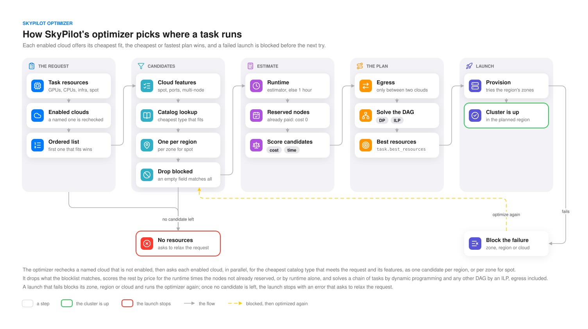
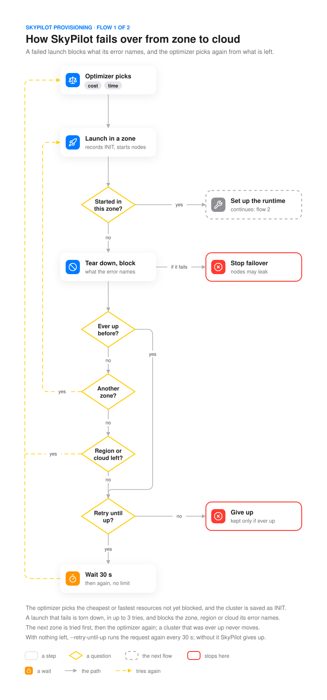
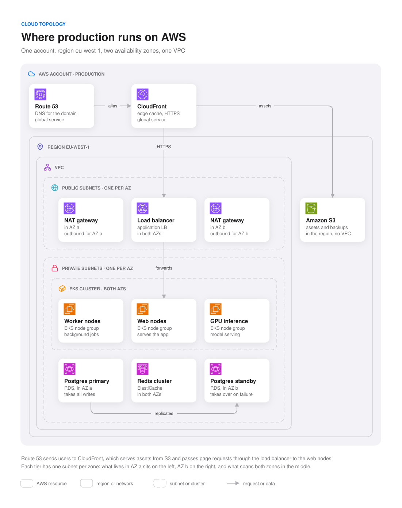
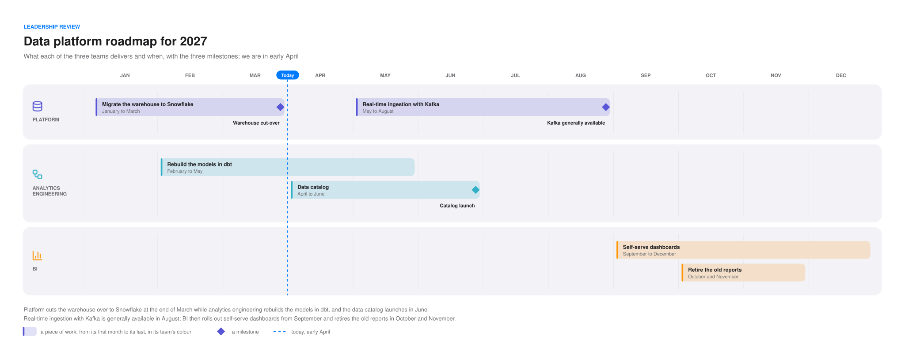
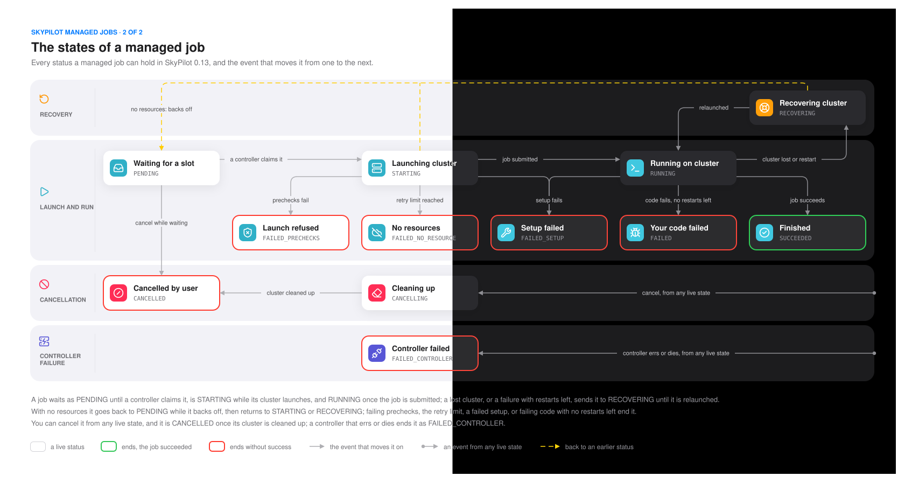

<!--
  The showcase of bento-diagrams, for the people deciding whether to use it. When the skill changes, update this file
  in place (AGENTS.md): keep its layout, its order and its voice, and change only what the change touched.

  Pictures: showcase/<name>.drawio is the source of showcase/<name>-light.svg and showcase/<name>-dark.svg. To render
  one again, run
      node scripts/render.mjs showcase/<name>.drawio --out <a temporary folder>
  and copy <name>-light.svg and <name>-dark.svg from that folder into showcase/. The picture split between the two
  themes is built from the same folder instead:
      node showcase/split.mjs job-states <that folder>

  Keep the pictures few and large: the strongest five, each a different composition. A pair sits on one row at one
  height: each picture's width is 99 % times its aspect ratio (the width and height of its SVG) over the sum of the
  pair's ratios: failover 0.47 and cloud-topology 0.79.
-->

<h1 align="center">🍱 Bento diagrams · 弁当</h1>

<p align="center">
  <b>Engineering diagrams your coding agent draws and a script checks.</b><br>
  Fifteen compositions, one visual language, one draw.io file for the light and the dark theme.
</p>

<p align="center">
  <a href="#install">Install</a> &nbsp;·&nbsp;
  <a href="#one-question-one-picture">What it draws</a> &nbsp;·&nbsp;
  <a href="#checked-like-code">The check</a> &nbsp;·&nbsp;
  <a href="SKILL.md">SKILL.md</a> &nbsp;·&nbsp;
  <a href="CHANGELOG.md">Changelog</a>
</p>

<br>

<p align="center">
  <picture>
    <source media="(prefers-color-scheme: dark)" srcset="showcase/optimizer-dark.svg">
    
  </picture>
</p>

<p align="center"><sub>How SkyPilot's optimizer picks where a task runs. Every picture on this page was drawn by a coding
agent with this skill, the SkyPilot ones from the source code they describe.</sub></p>

<br>

## A compartment for everything

A bentō (弁当) keeps each thing in its own compartment, and the arrangement carries the meaning. These diagrams work the
same way. Soft grey compartments hold the parts, cards say what each part is, thin arrows say what moves, and an
outline says how a path ends: green when it succeeds, red when it stops. Decisions and retries are yellow. The look is
Apple's system UI: a white or black page, the system colours, Instrument Sans.

## One question, one picture

The skill reads the question before it draws. Who does what is a swimlane, where things run is a set of nested boxes,
which way to go is a decision ladder, what a thing can become is a state machine, when is a roadmap.

<p align="center">
  <picture>
    <source media="(prefers-color-scheme: dark)" srcset="showcase/failover-dark.svg">
    
  </picture>
  <picture>
    <source media="(prefers-color-scheme: dark)" srcset="showcase/cloud-topology-dark.svg">
    
  </picture>
</p>

<p align="center"><sub>A decision ladder for a failover, and nested boxes for where production runs on AWS.</sub></p>

<p align="center">
  <picture>
    <source media="(prefers-color-scheme: dark)" srcset="showcase/roadmap-dark.svg">
    
  </picture>
</p>

<p align="center"><sub>A roadmap: bars as long as the work, milestones, and a line for today.</sub></p>

<p align="center"><sub>Swimlanes · stage columns · nested containers · hub and spoke · tree · decision tree · layered stack ·
sequence · data model · state machine · roadmap · comparison matrix · mind map · pillars · journey</sub></p>

Each composition has its grid in [references/drawio.md](references/drawio.md), so two agents asked the same question
draw the same picture. You choose nothing: asking for a diagram is enough. A picture of up to about eight cards gets
tall cards with two lines of detail; a larger one gets the compact density, about 30 % smaller.

## One file, both themes

Every colour is a light and dark pair inside one `.drawio` file, so the picture follows whatever shows it: the draw.io
editor, VS Code, a wiki, a slide. Light cards cast a soft shadow; dark ones cast none and stand out by their fill. A
product logo that would fade on one theme moves onto a chip by itself.

<p align="center">
  
</p>

<p align="center"><sub>The states of a managed job: one file, its left half in the light theme and its right half in the
dark one.</sub></p>

## Checked like code

`scripts/render.mjs` exports each page through draw.io, lays the text out in a real browser with the real fonts, and
does not call a picture done while anything is off:

- text that overlaps, runs past its cell, or leaves a diamond's slanted sides;
- a line through words, or through a card it does not connect, and two lines that cross without a bridge;
- near misses: words 6 px apart, a line 12 px from a name, a hole inside a box, a page wider on one side than the
  other;
- a credit, a watermark, a buzzword, an emoji or a number on a box.

```text
$ node scripts/render.mjs failover.drawio
overlap check: 4 problems
  "Another region left?" is wider than its box by 3 px
  "Another region left?" runs past the slanted sides of its diamond: shorten the lines or split them (about 10 characters a line in 120 x 80)
  a line (e1) passes 8 px from "retries": keep 12 px, or route it on the other side
  the page has 64 px of empty space on the right and 38 on the opposite side: resize the background to the picture
```

It exits with 1 until every page prints `overlap check: clean`. The `.drawio` is what you keep; the previews of both
themes it writes are only for looking.

## No AI slop

The pictures read as made by a careful engineer. There is no "made with" credit anywhere, not in the caption, not in
the file name. No gradients, glows or sparkles standing in for AI. No buzzwords, no exclamation marks, no numbers on
the boxes: the arrows give the order, and the caption tells it in plain sentences. A number appears only when the
source states it.

## Install

Any agent ([Claude Code, Codex, Cursor, Gemini CLI, Copilot and more](https://github.com/vercel-labs/skills)), with
Node.js:

```bash
npx skills add exdsgift/shuji-skills --skill bento-diagrams
```

Claude Code, as a plugin:

```bash
claude plugin install bento-diagrams --marketplace exdsgift/shuji-skills
```

Then ask in plain words:

> Draw how our webhook delivery retries with backoff.<br>
> Show where each part of the checkout runs on AWS.<br>
> Make a roadmap of the data platform for next year.

The agent picks the composition and the density, writes the `.drawio`, checks it and hands it over with a caption and
an alt text. The scripts need Node 18 or later, the draw.io desktop app, and Chrome or Edge.

<br>

<p align="center"><sub>The skill is under the <a href="LICENSE">MIT license</a>; a diagram's layout and words are yours
to use without its notice. The fonts it embeds, Instrument Sans and IBM Plex Mono, are under the SIL Open Font License;
the glyphs are Lucide (ISC). Product logos remain their owners' trademarks. The SkyPilot pictures are drawn from
SkyPilot's open source code.</sub></p>
