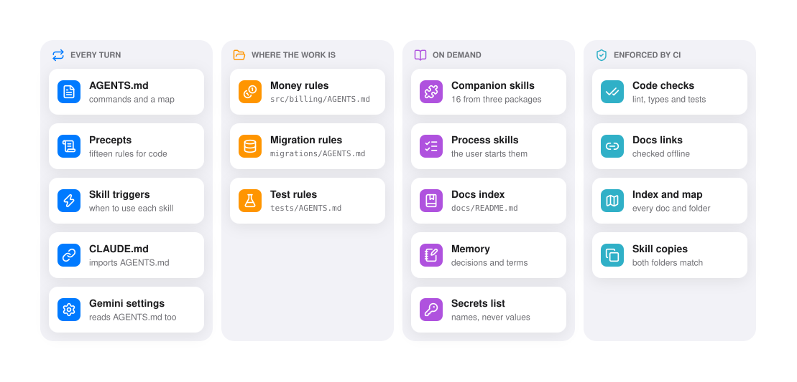

<!--
  The showcase of bushido-setup, for the people deciding whether to use it. When the skill changes, update this file
  in place (AGENTS.md): keep its layout, its order and its voice, and change only what the change touched.

  Pictures: showcase/<name>.drawio is the source of showcase/<name>-light.svg and showcase/<name>-dark.svg, drawn with
  the bento-diagrams skill. To render one again, run
      node ../bento-diagrams/scripts/render.mjs showcase/<name>.drawio --out <a temporary folder>
  and copy <name>-light.svg and <name>-dark.svg from that folder into showcase/. A picture holds the diagram alone,
  with no header, caption or legend: its title and caption are text in this file, to keep the picture clean.

  Sources: every source that shaped a decision is listed under "Sources", grouped by theme, with what it decided.
  Add a source in the same change as the decision it supports.
-->

<h1 align="center">⚔️ Bushido setup · 武士道</h1>

<p align="center">
  <b>A code of conduct for a codebase, set up by your coding agent.</b><br>
  Precepts from the classic manuals, the tools that enforce them, and instructions every agent reads.
</p>

<p align="center">
  <a href="#install">Install</a> &nbsp;·&nbsp;
  <a href="#what-it-sets-up">What it sets up</a> &nbsp;·&nbsp;
  <a href="#what-it-leaves-out">What it leaves out</a> &nbsp;·&nbsp;
  <a href="#sources">Sources</a> &nbsp;·&nbsp;
  <a href="SKILL.md">SKILL.md</a> &nbsp;·&nbsp;
  <a href="CHANGELOG.md">Changelog</a>
</p>

<br>

<p align="center"><b>What an agent reads, and when</b></p>

<p align="center">
  <picture>
    <source media="(prefers-color-scheme: dark)" srcset="showcase/layout-dark.svg">
    
  </picture>
</p>

<p align="center"><sub>Every agent reads the first column on every turn, so AGENTS.md stays under 100 lines; a folder's own
file loads when an agent works in that folder. Skills and docs load only when a task needs them, and CI checks what
written rules cannot enforce.</sub></p>

<br>

## Seven virtues, fifteen precepts

Bushidō (武士道) is the samurai's code of conduct. This skill gives a repository one, so code written by people and by
agents stays lean, modular and changed one atomic step at a time. The seven virtues are the spirit; the agents read
fifteen plain precepts.

| Virtue | In the codebase |
| --- | --- |
| 義 Rectitude | Every behaviour change ships with its tests, and a bug fix starts with a failing one. |
| 勇 Courage | Delete what is not needed: no speculative layer, no option nobody asked for. |
| 仁 Benevolence | Write for the next reader: precise names, comments that say why, docs that match the code. |
| 礼 Respect | Follow the code that is already there and the tools that format it. |
| 誠 Honesty | Say "done" only with evidence, and report what failed. |
| 名誉 Honour | One logical change per commit, small pull requests, a reviewer's go-ahead before you push. |
| 忠義 Loyalty | Keep the repo safe to make public: configuration from the environment, no secret in the code. |

## What it sets up

Ask your agent to set up a repo, new or old. It looks first, asks at most five questions, shows the plan as a file
tree, and writes only after your go-ahead.

- **The project.** The official generator of the stack does the skeleton: `uv init`, `pnpm create vite`,
  `go mod init`, `cargo new`. Python, TypeScript, Go and Rust are covered; any other stack gets everything but the
  skeleton.
- **The precepts.** Fifteen rules from the classic manuals in `AGENTS.md`: deep modules, dependencies pointing at the
  domain, one change per commit, tests with every change, configuration from the environment. Formatting is left to
  the formatter and the linter, which CI runs.
- **The agent files.** One short `AGENTS.md` that Claude Code, Codex, Cursor, Copilot and Gemini all read, a one-line
  `CLAUDE.md` that imports it, and an `AGENTS.md` in a folder only when that folder has a rule its code does not show.
- **Memory.** Decisions in `docs/adr/`, the project's words in `GLOSSARY.md`, a changelog when the project ships
  versions, and a list of the secrets with where each one lives, never its value.
- **Companion skills.** Sixteen skills from [Matt Pocock](https://github.com/mattpocock/skills),
  [ponytail](https://github.com/DietrichGebert/ponytail) and [superpowers](https://github.com/obra/superpowers),
  installed into the repo for every agent, each with one line in `AGENTS.md` saying when to use it.
- **CI.** Lint, format, types and tests, plus checks that the docs' links work, that the docs index and the folder map
  are complete, and that the skills' copies match.

Run it again on a set-up repo and it audits: what is missing, what drifted, what is fine, and the fixes it proposes.

## What it leaves out

Most of what agents are usually told does not help them. Studies of agent context files found that repository
overviews and generic commands add about a fifth to the cost and nothing to the result, that files a model wrote from
the code do worse than files people wrote, and that rules fade as a session grows. So the skill:

- writes only what the code does not show: your answers, your processes, your gotchas;
- keeps the root `AGENTS.md` under 100 lines, with no overview and no directory tree;
- writes a skill for a process only from the steps you describe, never from its own idea of a release;
- puts every rule that must hold into a tool: the linter, the type checker, CI;
- writes no empty file: a glossary, an ADR or a secrets list appears when it has content.

## Install

Any agent ([Claude Code, Codex, Cursor, Gemini CLI, Copilot and more](https://github.com/vercel-labs/skills)), with
Node.js:

```bash
npx skills add exdsgift/shuji-skills --skill bushido-setup
```

Claude Code, as a plugin:

```bash
claude plugin install bushido-setup --marketplace exdsgift/shuji-skills
```

Then ask in plain words:

> Set up this repo for coding agents.<br>
> Start a new Python service for payments with the right structure.<br>
> Audit the agent docs in this repository.

The skill runs the stack's own tools, so a Python setup needs uv, a TypeScript one pnpm or npm, and so on. The CI it
writes runs on GitHub Actions.

## Sources

Every decision in the skill rests on one of these. Each group says what it decided.

**The classic manuals: the fifteen precepts, and the side taken where the manuals disagree.**
Hunt and Thomas, *The Pragmatic Programmer*, 20th anniversary edition ([tips](https://pragprog.com/tips/));
Ousterhout, *A Philosophy of Software Design*, 2nd edition, and his [debate with Robert Martin](https://github.com/johnousterhout/aposd-vs-clean-code),
which settled function size by cohesion and deep modules;
Parnas, "On the Criteria To Be Used in Decomposing Systems into Modules" (CACM, 1972);
McConnell, *Code Complete*, 2nd edition;
Martin, *Clean Code* and *Clean Architecture*;
Fowler, *Refactoring*, 2nd edition ([refactoring.com](https://refactoring.com/)) and
[Presentation Domain Data Layering](https://martinfowler.com/bliki/PresentationDomainDataLayering.html);
Feathers, *Working Effectively with Legacy Code*;
Kernighan and Pike, *The Practice of Programming*;
Raymond, [*The Art of Unix Programming*](http://www.catb.org/esr/writings/taoup/html/ch01s06.html);
Evans, [*Domain-Driven Design Reference*](https://www.domainlanguage.com/ddd/reference/);
Freeman and Pryce, *Growing Object-Oriented Software, Guided by Tests*;
Beck, *Test-Driven Development by Example*;
[The Twelve-Factor App](https://12factor.net/config), [Conventional Commits](https://www.conventionalcommits.org/),
[Semantic Versioning](https://semver.org/), [Keep a Changelog](https://keepachangelog.com/),
[Google's engineering practices](https://google.github.io/eng-practices/) and
[trunk-based development](https://trunkbaseddevelopment.com/).

**How agents read instruction files: one `AGENTS.md`, a `CLAUDE.md` import beside each, folder files, no path rules.**
[agents.md](https://agents.md/);
Claude Code's [memory](https://code.claude.com/docs/en/memory), [skills](https://code.claude.com/docs/en/skills),
[best practices](https://code.claude.com/docs/en/best-practices) and
[large codebases](https://code.claude.com/docs/en/large-codebases) docs;
Codex's [AGENTS.md](https://learn.chatgpt.com/docs/agent-configuration/agents-md),
[skills](https://learn.chatgpt.com/docs/build-skills) and [best practices](https://learn.chatgpt.com/guides/best-practices)
docs, and its [source](https://github.com/openai/codex/blob/main/codex-rs/core/src/agents_md.rs);
Cursor's [rules](https://cursor.com/docs/context/rules) and [skills](https://cursor.com/docs/skills);
GitHub Copilot's [repository instructions](https://docs.github.com/en/copilot/how-tos/configure-custom-instructions/add-repository-instructions)
and [support matrix](https://docs.github.com/en/copilot/reference/custom-instructions-support);
VS Code's [custom instructions](https://code.visualstudio.com/docs/copilot/customization/custom-instructions);
Gemini CLI's [GEMINI.md](https://geminicli.com/docs/cli/gemini-md/) and its
[source](https://github.com/google-gemini/gemini-cli/blob/main/packages/core/src/utils/memoryDiscovery.ts);
Antigravity's [CLI migration guide](https://antigravity.google/docs/cli/gcli-migration);
the [Agent Skills specification](https://agentskills.io/specification);
Git's [`core.symlinks`](https://git-scm.com/docs/git-config), which is why skills are committed as copies; and our
own tests of Claude Code 2.1.299 and Codex 0.162.1.

**What helps an agent and what does not: a short root, facts from people, a line that triggers each skill, tools over
prose.**
Gloaguen et al., [Evaluating AGENTS.md](https://arxiv.org/abs/2602.11988) (ETH Zurich, 2026);
Lulla et al. ([arXiv 2601.20404](https://arxiv.org/abs/2601.20404));
Khatri ([arXiv 2607.27250](https://arxiv.org/abs/2607.27250));
McMillan ([arXiv 2605.10039](https://arxiv.org/abs/2605.10039));
Vercel, [AGENTS.md outperforms skills in our agent evals](https://vercel.com/blog/agents-md-outperforms-skills-in-our-agent-evals);
[SkillsBench](https://arxiv.org/abs/2602.12670), [SWE-Skills-Bench](https://arxiv.org/abs/2603.15401),
[Skill-Use](https://arxiv.org/abs/2608.04828) and [One Skill Too Many](https://arxiv.org/abs/2610.11647);
[IFScale](https://arxiv.org/abs/2507.11538), [Lost in the Middle](https://arxiv.org/abs/2307.03172) and Chroma's
[Context Rot](https://www.trychroma.com/research/context-rot);
the studies of [agent READMEs](https://arxiv.org/abs/2511.12884) and of
[AGENTS.md smells](https://arxiv.org/abs/2606.15828);
Anthropic, [Effective context engineering for AI agents](https://www.anthropic.com/engineering/effective-context-engineering-for-ai-agents)
and [Equipping agents for the real world with Agent Skills](https://www.anthropic.com/engineering/equipping-agents-for-the-real-world-with-agent-skills);
OpenAI, [Harness engineering](https://openai.com/index/harness-engineering/).

**How the agent files are written: ten sentence rules, not the full standard.**
ASD-STE100 Simplified Technical English ([asd-ste100.org](https://asd-ste100.org/), used as inspiration only: the
rules are our own words, and our rewrites in strict STE came out about 30% longer);
Motger et al. ([arXiv 2608.27621](https://arxiv.org/abs/2608.27621));
Leidinger, van Rooij and Shutova, [The language of prompting](https://arxiv.org/abs/2311.01967);
Sclar et al. ([ICLR 2024](https://arxiv.org/abs/2310.11324)) and He et al. ([arXiv 2411.10541](https://arxiv.org/abs/2411.10541))
on prompt-format sensitivity;
Anthropic's [prompting best practices](https://platform.claude.com/docs/en/build-with-claude/prompt-engineering/claude-prompting-best-practices)
and [skill authoring best practices](https://platform.claude.com/docs/en/agents-and-tools/agent-skills/best-practices);
Matt Pocock's `writing-for-agents` skill.

**Docs and secrets: an index, ADRs, a glossary, no architecture overview, a secrets table without values.**
[Diátaxis](https://diataxis.fr/); Michael Nygard,
[Documenting Architecture Decisions](https://www.cognitect.com/blog/2011/11/15/documenting-architecture-decisions);
[MADR](https://adr.github.io/madr/); matklad's [ARCHITECTURE.md](https://matklad.github.io/2021/02/06/ARCHITECTURE.md.html),
weighed and left out on the evidence above; [llms.txt](https://llmstxt.org/), the shape of the docs index;
OWASP's [Secrets Management Cheat Sheet](https://cheatsheetseries.owasp.org/cheatsheets/Secrets_Management_Cheat_Sheet.html);
GitHub's docs on [community health files](https://docs.github.com/en/communities/setting-up-your-project-for-healthy-contributions/creating-a-default-community-health-file),
[secret scanning](https://docs.github.com/en/code-security/secret-scanning/introduction/about-secret-scanning) and
[push protection](https://docs.github.com/en/code-security/secret-scanning/introduction/about-push-protection);
the AGENTS.md files of [Sentry](https://github.com/getsentry/sentry/blob/master/AGENTS.md),
[Airflow](https://github.com/apache/airflow/blob/main/AGENTS.md), [uv](https://github.com/astral-sh/uv/blob/main/AGENTS.md)
and [rust-analyzer](https://github.com/rust-lang/rust-analyzer/blob/master/CLAUDE.md).

**The project skeleton: official generators, current tools, one CI.**
[uv](https://docs.astral.sh/uv/concepts/projects/init/), the
[Python packaging guide](https://packaging.python.org/en/latest/discussions/src-layout-vs-flat-layout/),
[Ruff](https://docs.astral.sh/ruff/) and [pytest](https://docs.pytest.org/en/stable/explanation/goodpractices.html);
TypeScript's [module options](https://www.typescriptlang.org/docs/handbook/modules/guides/choosing-compiler-options.html),
[pnpm](https://pnpm.io/workspaces), [Vite](https://vite.dev/guide/),
[create-next-app](https://nextjs.org/docs/app/api-reference/cli/create-next-app), [Biome](https://biomejs.dev/) and
[Vitest](https://vitest.dev/guide/); Go's [module layout](https://go.dev/doc/modules/layout) and
[golangci-lint](https://golangci-lint.run/); the [Cargo book](https://doc.rust-lang.org/cargo/guide/project-layout.html);
[github/gitignore](https://github.com/github/gitignore), [EditorConfig](https://editorconfig.org/),
GitHub's [line endings](https://docs.github.com/en/get-started/git-basics/configuring-git-to-handle-line-endings),
[Actions security](https://docs.github.com/en/actions/reference/security/secure-use) and
[Dependabot ecosystems](https://docs.github.com/en/code-security/dependabot/ecosystems-supported-by-dependabot/supported-ecosystems-and-repositories)
docs; [choosealicense.com](https://choosealicense.com/); [lychee](https://github.com/lycheeverse/lychee).

**The companion skills: which to install, one owner per job, real copies.**
[mattpocock/skills](https://github.com/mattpocock/skills), [DietrichGebert/ponytail](https://github.com/DietrichGebert/ponytail),
[obra/superpowers](https://github.com/obra/superpowers) and the [skills CLI](https://github.com/vercel-labs/skills).

## License and credits

The skill is under the [MIT license](LICENSE). The text it writes into your repository from this skill, the precepts
included, may be used without that notice. The files it writes from Matt Pocock's templates keep his MIT notice,
which it writes beside them.

The diagram at the top embeds Instrument Sans and IBM Plex Mono, under the SIL Open Font License, and Lucide glyphs,
under the ISC license.

The `docs/agents/` templates in [assets/docs-agents/](assets/docs-agents/) come from Matt Pocock's
`setup-matt-pocock-skills`, under the MIT license (Copyright (c) 2026 Matt Pocock; the notice is in
[LICENSE-mattpocock-skills](assets/docs-agents/LICENSE-mattpocock-skills)). The companion skills are installed from
their own repositories, never copied into this one. ASD-STE100 is a trademark of ASD; this skill names it as an
inspiration and follows none of its text.
