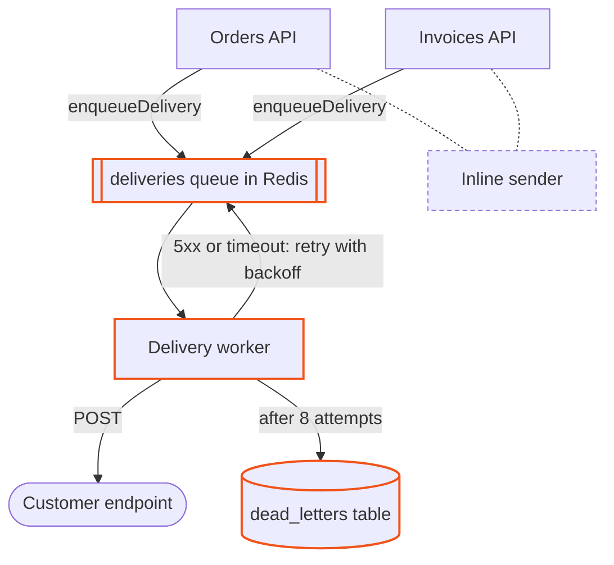

<!--
  The showcase of sumi-diagrams, for the people deciding whether to use it. When the skill changes, update this file
  in place (AGENTS.md): keep its layout, its order and its voice, and change only what the change touched.

  Pictures: showcase/<name>.mmd is the source of showcase/<name>-light.svg and showcase/<name>-dark.svg. To render one
  again, run
      node scripts/render.mjs showcase/<name>.mmd --destination readme --out showcase --now 2026-10-18
  The sources come from reviewed evaluation results, the same as samples/. The block under "In a pull request" is
  not a picture: GitHub draws it, as it would in a pull request; it is samples/pull-request-flowchart.mmd.

  Keep the pictures few and large, each a different type. A pair sits on one row at one height: each picture's width
  is 99 % times its aspect ratio (the width and height of its SVG) over the sum of the pair's ratios: sequence 1.563
  and gitgraph 1.316, xychart-lines 1.400 and pie 1.869.
-->

<h1 align="center">🖌️ Sumi diagrams · 墨</h1>

<p align="center">
  <b>Mermaid diagrams and charts your coding agent writes, renders with Pele and checks.</b><br>
  All 32 types, grey with one accent, one SVG for the light and the dark theme.
</p>

<p align="center">
  <a href="#install">Install</a> &nbsp;·&nbsp;
  <a href="#one-question-one-type">What it draws</a> &nbsp;·&nbsp;
  <a href="#checked-like-code">The check</a> &nbsp;·&nbsp;
  <a href="SKILL.md">SKILL.md</a> &nbsp;·&nbsp;
  <a href="CHANGELOG.md">Changelog</a>
</p>

<br>

<p align="center">
  <picture>
    <source media="(prefers-color-scheme: dark)" srcset="showcase/flowchart-architecture-dark.svg">
    
  </picture>
</p>

<p align="center"><sub>A checkout service for a README: the payment service is the one a pull request changes, Cloudflare
and Stripe are outside the system. Every picture on this page was drawn by a coding agent with this skill.</sub></p>

<br>

## Mermaid, drawn by Pele

The source of every diagram is Mermaid text: it lives in the repository, reads in a diff, and an agent can edit it
next week. [Pele](https://pele.run) renders it: the Mermaid renderer Obsidian built for its next version, with its own
layout, no dependencies, and a few milliseconds per diagram. It reads Mermaid 12.1 syntax and draws every type Mermaid
has, including the new ones (swimlane, agentflow, tree view, wardley, venn, ishikawa).

## Ink and one seal

Sumi (墨) is the ink of East Asian brush painting: a picture in grey ink, and one vermilion seal. These diagrams work
the same way. Boxes, lines and words are grey. One orange accent marks the arrowheads, so the eye follows the flow,
and outlines the one node a diagram is about. A dashed outline marks what is outside the system. Nothing else carries colour: no fills
by hand, no traffic lights. A chart with one series wears the same orange; with several, the series take the
Okabe-Ito colours, ordered so that neighbours stay apart for colour-blind readers.

<p align="center">
  <picture>
    <source media="(prefers-color-scheme: dark)" srcset="showcase/sequence-dark.svg">
    
  </picture>
  <picture>
    <source media="(prefers-color-scheme: dark)" srcset="showcase/gitgraph-dark.svg">
    
  </picture>
</p>

<p align="center"><sub>A sequence written into an Obsidian note, and a branching model for a CONTRIBUTING section.</sub></p>

One SVG serves both themes: the colours are CSS variables, and the dark ones take over when the reader's system is
dark. A README gets a light and a dark file instead, because GitHub picks the image by the theme the reader chose on
GitHub.

## One question, one type

The skill reads the question before it picks the type. Who does what is a swimlane, who calls whom is a sequence,
what it can become is a state machine, what the database holds is an ER diagram, when is a gantt.

<p align="center">
  <picture>
    <source media="(prefers-color-scheme: dark)" srcset="showcase/xychart-lines-dark.svg">
    
  </picture>
  <picture>
    <source media="(prefers-color-scheme: dark)" srcset="showcase/pie-dark.svg">
    
  </picture>
</p>

<p align="center"><sub>Three named series for a weekly report, and a bill folded to five slices.</sub></p>

<p align="center"><sub>Flowchart · swimlane · agentflow · user journey · sequence · state · use case · event modeling ·
class · ER · C4 · architecture · block · requirement · packet · mindmap · tree view · treemap · ishikawa · gantt ·
timeline · git graph · kanban · pie · XY · quadrant · radar · sankey · venn · wardley · cynefin · railroad</sub></p>

Each family has its reference in [references/](references/): a verified example per type, its syntax, and what Pele
1.6.0 rejects or quietly misreads.

## Where it goes

| Where the reader sees it | What the skill delivers |
| --- | --- |
| An Obsidian note | the Mermaid block in the note, checked at note and phone width |
| A README on GitHub or GitLab | a light and a dark SVG, the `<picture>` to paste, and the source |
| A docs site, a wiki, a slide | one SVG for both themes, and the source |
| A pull request on GitHub | a Mermaid block for the description, the change outlined in orange |

GitHub draws Mermaid blocks with Mermaid.js, in its own look, so a README gets the pictures, which keep this one; a
pull request gets the block.

<p align="center">
  <picture>
    <source media="(prefers-color-scheme: dark)" srcset="showcase/state-dark.svg">
    
  </picture>
</p>

<p align="center"><sub>The states of a renderer, drawn for a docs page.</sub></p>

## In a pull request

A reviewer reads a change faster when they can see it. When a pull request changes who calls whom, a message
exchange, states, the schema, types or branch history, the skill puts one Mermaid block in its description, built
from what the pull request work already gathered: the commits and the diff. What the pull request adds is outlined
in the same orange, and what it deletes is dashed, in GitHub's light theme and its dark one alike. GitHub draws the
block with Mermaid.js 12.1, which reads the syntax Pele reads, so the script checks it with Pele and previews it with
that Mermaid.js. A fix inside one function, a dependency bump or a config change gets no diagram.



<p align="center"><sub>A pull request that moves webhooks to a queue, drawn by an agent with this skill. GitHub draws
the block above itself, in the theme you read it in.</sub></p>

The first time it draws in a repository on GitHub, the skill asks once whether its pull requests should get one. A yes
writes a short rule into `AGENTS.md`, or the instructions file the repository uses, so any agent preparing a pull
request adds the diagram, with Matt Pocock's [pr skill](https://github.com/mattpocock/skills/tree/main/skills/engineering/pr)
or without it; a no writes one line, so no agent asks again.

## Checked like code

`scripts/render.mjs` renders the source with Pele, embeds the theme, and does not call a diagram done while anything
is off:

- the mistakes Pele and Mermaid let through without an error: a style on a node that does not exist, a Gantt date that
  misses its format, a `<Word>` dropped as a tag, a label that will not wrap;
- the parse errors agents meet most, all at once, each with its fix;
- an edge through a node, labels on top of each other, edges that cross;
- a picture so wide that its text would shrink below 11 px where it is shown;
- words measured in a real browser font, and previews of both themes for the agent to look at.

```text
$ node scripts/render.mjs webhook.mmd
syntax at line 3, column 39: Parse error on line 3:
    verify -->|yes| parse[Parse payload (JSON)]
  --------------------------------------^
  also: add "accTitle: …" and "accDescr: …" after the first line: they become the SVG's title and description, and the alt text
  also: the label [Parse payload (JSON)] holds ( ) { } | or @: put it in double quotes, ["Parse payload (JSON)"]
  also: "verify -->|no| reject[Return 401] --> end" uses "end" as a node: it is a keyword, so name the node End, done or finish
  also: "parse --> enqueue[Push to queue] %% async" has a %% comment after code: give the comment a line of its own
check: failed
```

It exits with 1 until it prints `check: clean`.

## Facts, not inventions

Every node, edge and number comes from the request, the code or the docs the agent was given; when a missing fact
would change the picture, the agent asks. Labels are short and use the system's real names. Every diagram carries a
title and a description, which become the SVG's accessible name and its alt text. Nothing signs the picture.

## Install

Any agent ([Claude Code, Codex, Cursor, Gemini CLI, Copilot and more](https://github.com/vercel-labs/skills)), with
Node.js:

```bash
npx skills add exdsgift/shuji-skills --skill sumi-diagrams
```

Claude Code, as the `shuji` plugin, which brings every shuji skill and runs this one as `/shuji:sumi-diagrams`:

```bash
claude plugin install shuji --marketplace exdsgift/shuji-skills
```

Then ask in plain words:

> Add an architecture diagram of the checkout service to the README.<br>
> Put a sequence diagram of the OAuth flow in my note auth.md.<br>
> Chart these latency numbers for the weekly report.<br>
> Add a diagram of what this branch changes to the PR description.

The script needs Node 20 or later and installs Pele 1.6.0 from npm on its first run. It uses Chrome, Edge or Chromium
for the font check and the previews when it finds one, and says what it skipped when it does not.

## Sources

- Pele, the renderer: [pele.run](https://pele.run) and [obsidianmd/pele](https://github.com/obsidianmd/pele), version
  1.6.0; Mermaid syntax: [mermaid.js.org](https://mermaid.js.org).
- Series colours: M. Okabe and K. Ito, [Color Universal Design (CUD): how to make figures and presentations that are
  friendly to colorblind people](https://jfly.uni-koeln.de/color/), 2002, revised 2008.
- Colour-blind checks: G. M. Machado, M. M. Oliveira and L. A. F. Fernandes, [A physiologically-based model for
  simulation of color vision deficiency](https://www.inf.ufrgs.br/~oliveira/pubs_files/CVD_Simulation/CVD_Simulation.html),
  IEEE Transactions on Visualization and Computer Graphics 15(6), 2009,
  [doi:10.1109/TVCG.2009.113](https://doi.org/10.1109/TVCG.2009.113); colour distances in
  [Oklab](https://bottosson.github.io/posts/oklab/) (B. Ottosson, 2020).
- Pull requests: GitHub Docs, [Creating diagrams](https://docs.github.com/en/get-started/writing-on-github/working-with-advanced-formatting/creating-diagrams);
  the Mermaid.js version, 12.1.0, read from GitHub's Mermaid viewer on 18 October 2026.
- Contrast: W3C, WCAG 2.2, [1.4.11 Non-text Contrast](https://www.w3.org/WAI/WCAG22/Understanding/non-text-contrast.html)
  and [1.4.1 Use of Color](https://www.w3.org/WAI/WCAG22/Understanding/use-of-color.html).

<br>

<p align="center"><sub>The skill is under the <a href="LICENSE">MIT license</a>; a diagram's layout and words are yours
to use without its notice. Pele is MIT, © 2026 kepano; the skill installs it from npm and does not ship it.</sub></p>
