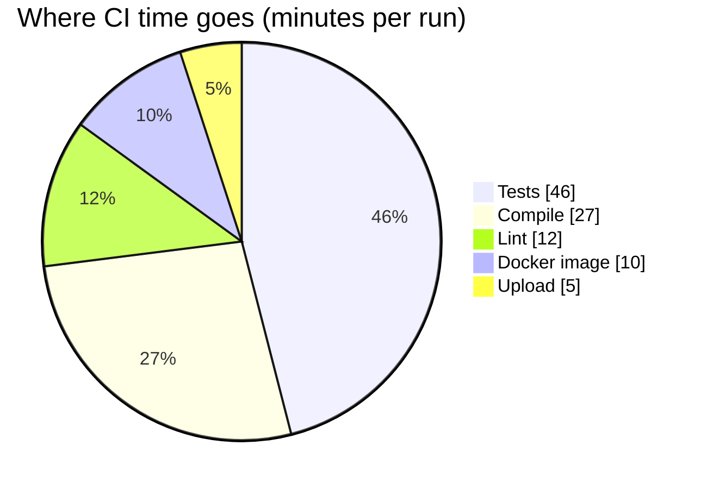
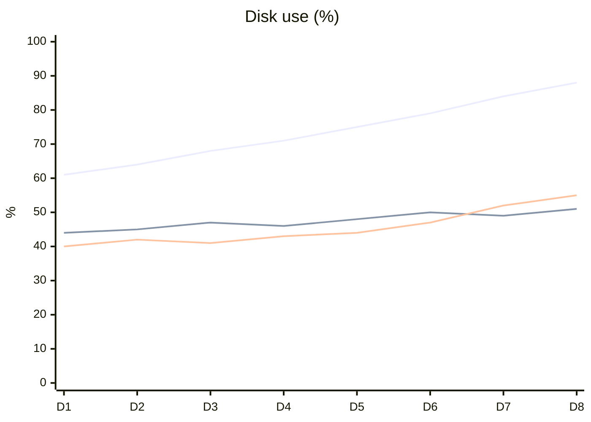
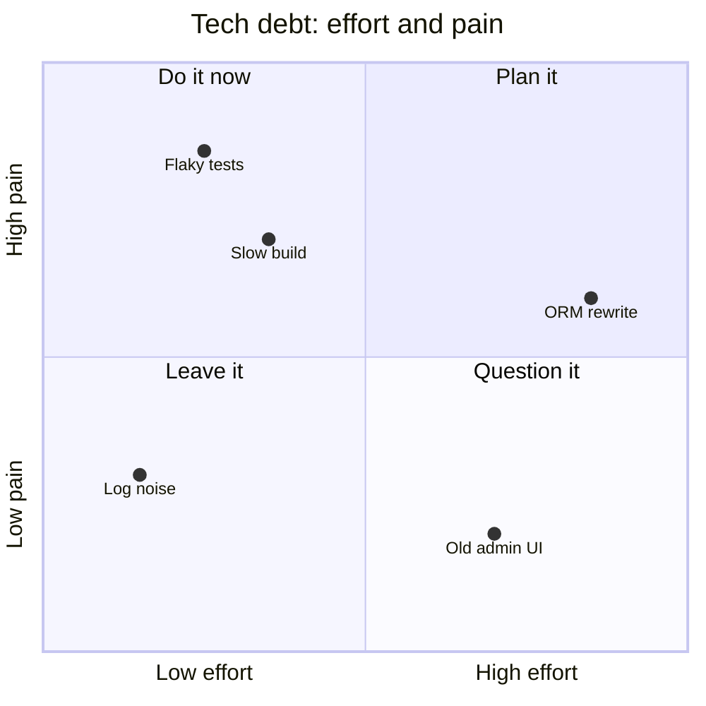
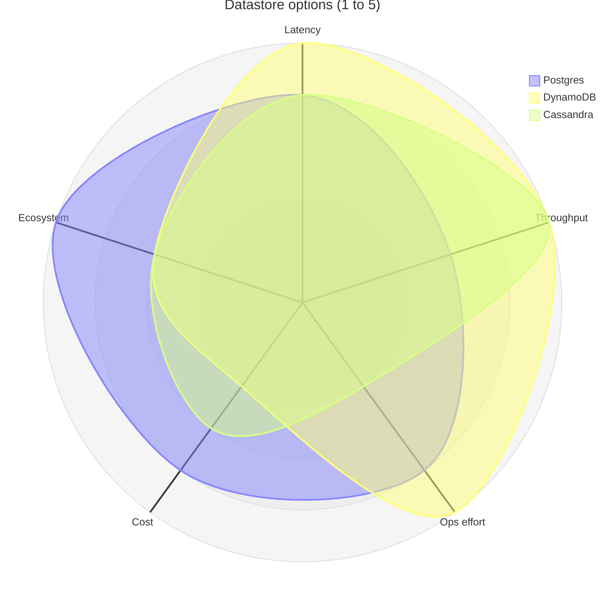
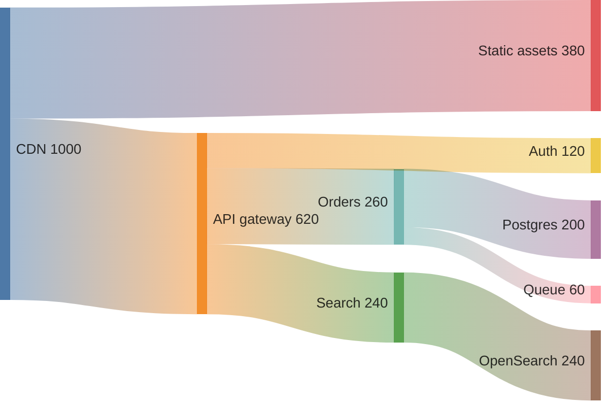
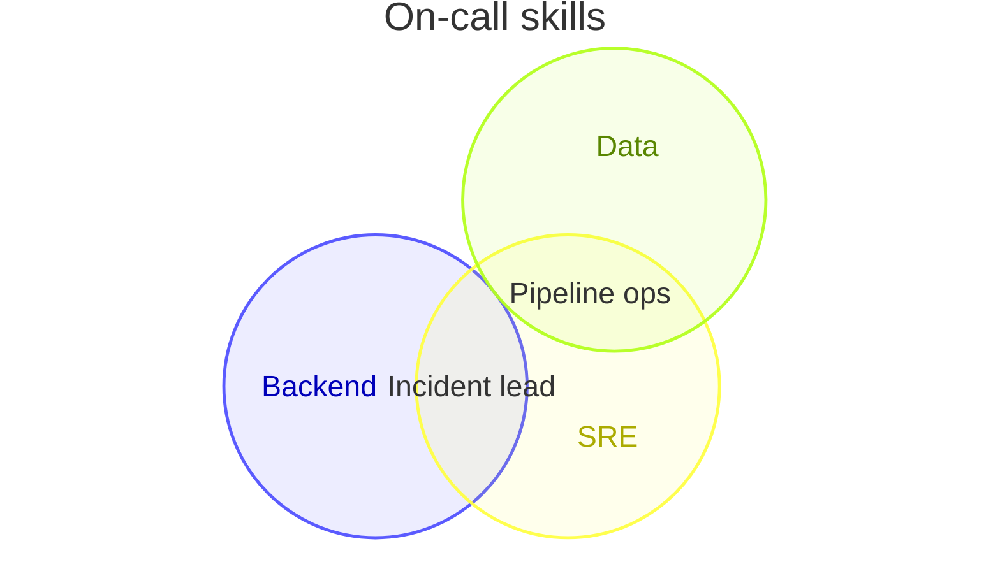

# Charts: pie, xychart, quadrant, radar, sankey, venn

Read this when the request carries numbers to show. Every example below renders clean with `scripts/render.mjs` on
Pele 1.6.0.

A chart with one series (one bar or line series, the points of a quadrant, one radar curve, a git graph with only
`main`) wears the accent, the theme's orange, so a picture never carries a second colour it does not need; the script
does this by itself. From two series on, colour says which series is which: series wear the Okabe-Ito colours (Okabe
& Ito 2008) in the theme's fixed order: blue, green, vermillion, pink, orange, sky, yellow. In that order every two neighbours stay apart under
protanopia and deuteranopia (worst simulated distance 11, against a target of 8). Three rules follow:

- The first series takes the first colour, always; a series keeps its colour when others are added or removed.
- Six series at most. A seventh becomes "Other", or the chart splits into small multiples.
- Sky and yellow, the sixth and seventh colours, are pale on white: a chart that reaches them labels its series
  directly or keeps the legend beside them. Never rely on colour alone: give every series a name so it has a
  legend entry.
- One measure per chart: never two y-axes. Two measures with different units make two charts.

## Pie

Answers: how one whole splits into a few parts.

- `"Label" : value`, labels always quoted. `showData` prints the values in the legend.
- Order the slices from largest to smallest; past five slices fold the smallest into "Other" and name what it holds
  in the description, not in the slice. Keep slice names under about 24 characters: Pele centres each legend entry
  on its own width estimate, so long names drift. For changes over time or comparisons between wholes, use bars.

## XY chart

Answers: how a value changes over an ordered axis (time, version, size), or how categories compare.

- `x-axis [a, b, c]` for categories or `x-axis "Label" 0 --> 100` for numbers; `y-axis "Label" min --> max`.
  `bar [...]` and `line [...]` series; `xychart horizontal` turns the bars.
- Name every series, `line "API" [...]`: with names Pele draws a legend; without them the reader cannot tell the
  lines apart. Past three lines, split the chart.
- One bar series is one colour, the accent: a bar's length already shows its value, so never colour bars by value.
- Start a bar axis at 0. Frontmatter `config: xyChart: showDataLabel: true` prints the values on the bars.

## Quadrant

Answers: where items sit on two judgements: effort and impact, risk and value.

- Points are `Name: [x, y]` with both numbers between 0 and 1; outside that range is a syntax error.
- `quadrant-1` is top right, then counter-clockwise: 2 top left, 3 bottom left, 4 bottom right.

## Radar

Answers: how a few options compare on several criteria of the same scale.

- `axis id["Label"], …` then `curve id["Name"]{v1, v2, …}` with one value per axis, in axis order.
- `max`, `min`, `graticule polygon` (or `circle`). Three curves at most: past that, use a table or bars.

## Sankey

Answers: how a quantity flows and splits between stages: traffic, budget, energy.

- One `source,target,value` row per flow. Names are plain ASCII with no quotes in Pele 1.6.0: no accents, no
  CJK, no commas.
- Sankey cannot hold `accTitle`/`accDescr` statements: write them as `%%` comments at column 0, as above.
- Nodes take the series colours in the order they first appear, and the eighth node onward is grey: list the main
  flows first. Frontmatter `config: sankey: suffix: "k"` adds a unit to the values; `showValues: false` hides them.
- Past about 12 nodes the labels collide: merge small flows.

## Venn

Answers: how a few sets overlap: skills, features, responsibilities.

- `set Name` or `set A["Label"]:size`; `union A,B["Label"]`; `text A1["Item"]` under a set lists its items.
- Three sets at most. Venn cannot hold `accTitle`/`accDescr` statements: write them as `%%` comments.
