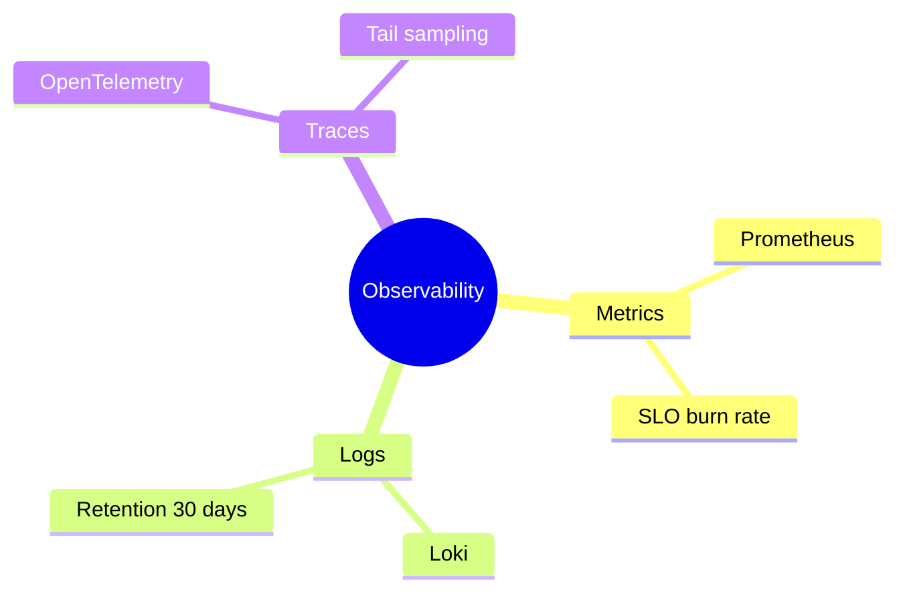
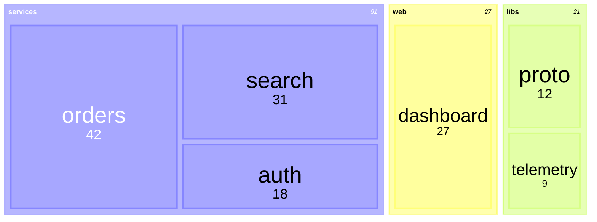
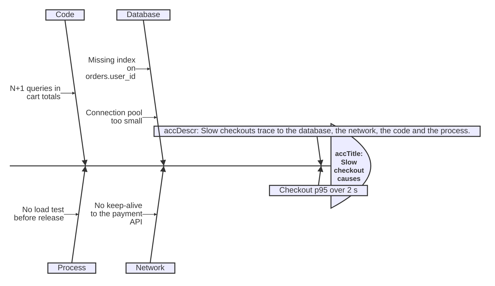

# Hierarchies: mindmap, tree view, treemap, ishikawa

Read this when the question is "what does it break down into?". Every example below renders clean with
`scripts/render.mjs` on Pele 1.6.0.

## Mindmap

Answers: what the parts of a topic are, branching from one centre: an overview, onboarding topics, a brainstorm.

- Indentation is the structure: every child is indented more than its parent, with spaces only and the same step
  throughout. Mixed indentation re-parents nodes without an error.
- Shapes: `((circle))` for the root, `[square]`, `(rounded)`, `{{hexagon}}`, `))bang((`, `)cloud(`.
- Mindmap cannot hold `accTitle`/`accDescr` statements: write them as `%%` comments at column 0, as above.
- Past about 25 nodes, split by branch.

## Tree view

Answers: how files and folders nest: a repository layout, a package, a config tree.

- Two forms: children indented under their folder with spaces, or `tree` output (`├──`, `└──`, `│`) pasted as it
  is, as above. Box-drawing lines start at column 0 even when `accTitle` and `accDescr` are indented: indented
  box-drawing lines fail ("Unexpected indentation without box-drawing characters"). A trailing `/` marks a folder.
- `## text` after a name adds a description. `:::highlight` is the tree view's key: it marks the one file the text
  is about.
- Icons: frontmatter `config: treeView: showIcons: true` draws file icons from Pele's set; leave them off unless
  asked.

## Treemap

Answers: how a total divides into nested parts, sized by value: disk use, a budget, lines of code.

- Quoted names, nested by indentation; leaves carry `: value`. Frontmatter `config: treemap: valueFormat: '$0,0'`
  formats the numbers.
- Each top-level item takes the next series colour, and everything under it shares that colour. Do not wrap the
  whole tree in one root (`"monorepo"`): a single top-level item paints the whole map in one colour. Name the total
  in the title instead. Keep to five or fewer top-level items.

## Ishikawa

Answers: what causes contribute to one problem, sorted by category.

- The first line is the problem; each unindented line after it is a category; indented lines are causes, and causes
  can nest.
- On a narrow screen Pele draws it as a cause tree.
