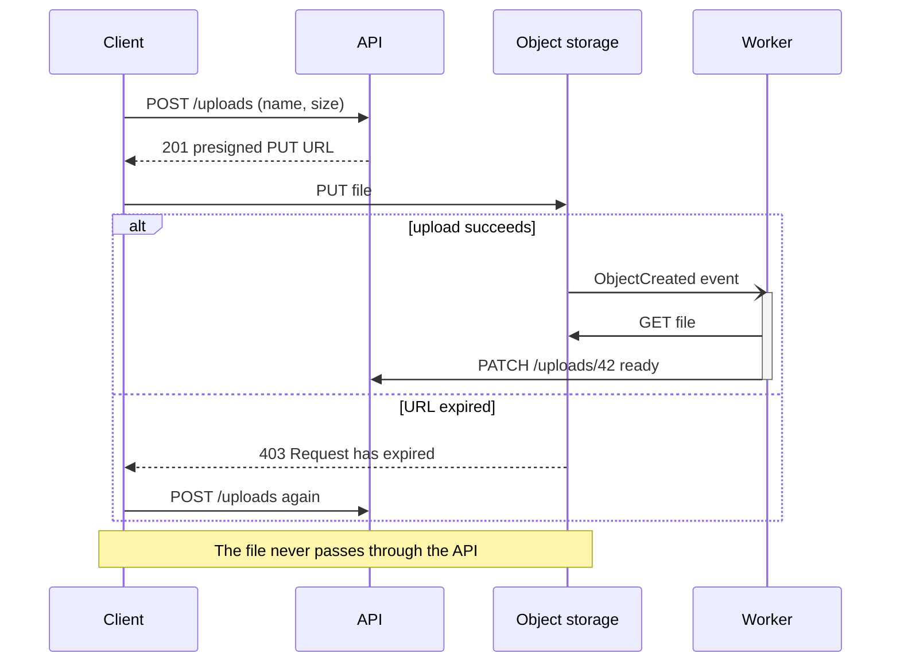
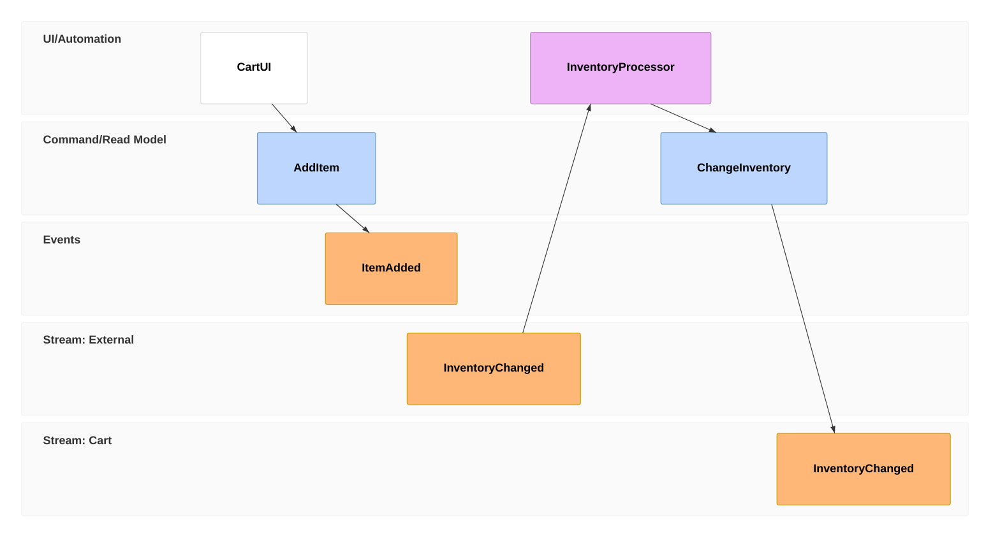

# Interactions: sequence, state, use case, event modeling

Read this when the question is "who calls whom, when?" or "what can it become?". Every example below renders clean
with `scripts/render.mjs` on Pele 1.6.0.

## Sequence

Answers: which messages participants exchange, in time order: an API call chain, a protocol, an auth flow.



- `participant X as Long name` (or `actor`) once, then use the short id. A name with spaces needs the alias.
- Arrows: `->>` call, `-->>` reply, `-)` async, `-x` lost or failed. A message is `A->>B: text`; a `;` ends the
  line early, so write "and" instead.
- Blocks: `alt … else … end`, `opt`, `loop every 55 min`, `par … and … end`, `critical … option … end`,
  `break`, `rect` (a fixed colour: avoid). `activate`/`deactivate` draw activation bars; `autonumber` numbers
  the messages, worth it only when the text refers to step numbers.
- `Note over A,B: text`, `Note right of A: text`. `create participant` and `destroy` for short-lived actors.
- Pele: lifelines are dashed in this theme; a long message label sits over the lifelines it crosses, so keep labels
  under about 40 characters. A message to self whose label has several lines can overlap the next message.
- More than six participants or 25 messages: split by phase.

## State

Answers: what states a thing can be in and which events move it: an order, a job, a connection.

```mermaid
stateDiagram-v2
  accTitle: Order lifecycle
  accDescr: An order is placed, paid, packed, shipped and delivered; unpaid orders and customer cancellations end refunded or cancelled.
  [*] --> Placed
  Placed --> Paid : payment captured
  Paid --> Packed : picked
  Packed --> Shipped : handed to carrier
  Shipped --> Delivered : signed
  state returned <<choice>>
  Delivered --> returned
  returned --> Complete : otherwise
  returned --> Refunded : returned within 14 days
  Placed --> Cancelled : unpaid 30 min
  Paid --> Cancelled : customer cancels
  Cancelled --> Refunded : if paid
  Complete --> [*]
  Refunded --> [*]
```



- `A --> B : event` labels a transition with the event that causes it. `[*]` is the start and the end.
- `state "Waiting for payment" as Waiting` for a long name. `state Review { … }` nests states; `--` inside splits
  concurrent regions. `<<choice>>`, `<<fork>>`, `<<join>>` are pseudo-states.
- `note right of Shipped : tracking number sent` adds a note.
- Pele: state diagrams ignore `curve`. Name states with nouns or participles (`Paid`, `Shipped`), events with verbs.
- Transitions are laid out in source order: if two of them cross, declare the main path first and the returns last.
- A `<Word>` in a transition label is dropped as an HTML tag: write `#lt;` and `#gt;`.

## Use case

Answers: which actors reach which goals with a system, and where its boundary is.

```mermaid
usecase-beta
  accTitle: Online ordering use cases
  accDescr: Customers browse and check out in the storefront; checkout includes payment; staff review orders.
  direction LR
  actor Customer
  actor Staff("Order staff")
  systemBoundary shop["Storefront"]
    Browse("Browse products")
    Checkout("Check out")
    Pay("Process payment")
    Review("Review order")
  end
  Customer --> Browse
  Customer --> Checkout
  Checkout ..> : include Pay
  Staff --> Review
```

- `actor Name` or `actor Id("Long name")`; use cases as `Id("Label")`; `systemBoundary id["Name"] … end`.
- `A ..> : include B` and `A ..> : extend B` for the UML relations; `A --|> B` for generalisation.
- `note for Checkout "text"` adds a note.

## Event modeling

Answers: how commands, events and views change a system over time, frame by frame.



- Each line is a frame: `tf NN kind Name` (`timeframe`), or `rf` (`resetframe`) to start a new sequence. Kinds:
  `ui`, `cmd` (`command`), `evt` (`event`), `rmo` (read model), `pcr` (`processor`).
- `tf 02 cmd AddItem [[AddItem01]]` points at a `data AddItem01 { field: value }` block shown with the frame.
- `rf 03 rmo CartItems ->> 01` draws a read model fed by frame 01.
- This type cannot hold `accTitle`/`accDescr` statements: write them as `%%` comments, as above, and the script puts
  them into the SVG.
- Narrow screens stack the frames down the page.
