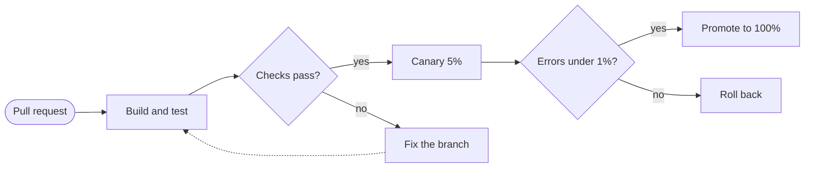
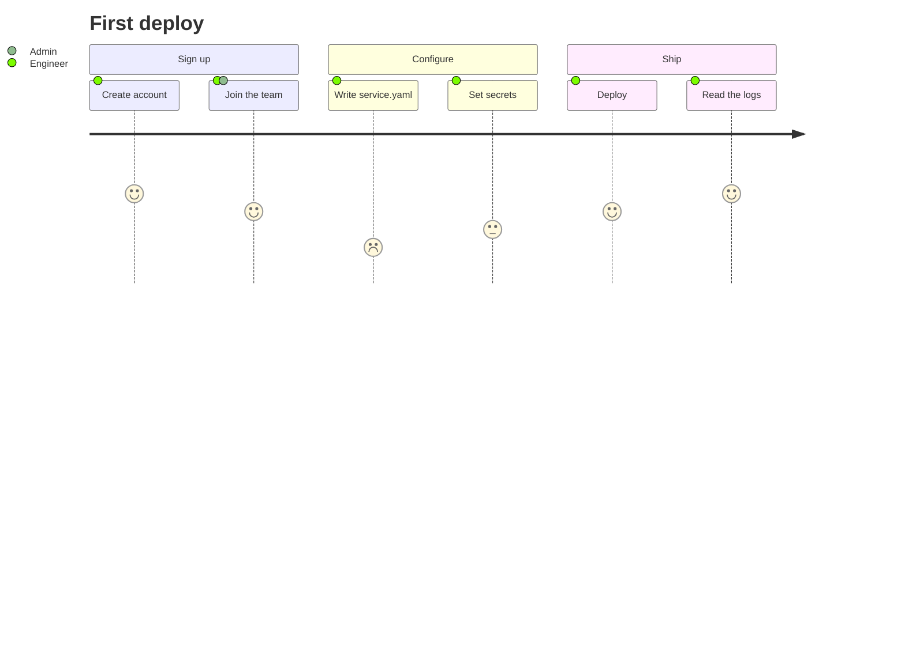

# Processes: flowchart, swimlane, agentflow, journey

Read this when the question is "what happens, in what order?". Every example below renders clean with
`scripts/render.mjs` on Pele 1.6.0.

## Flowchart

Answers: what are the steps and decisions of a process, or what talks to what in a system.



- Direction: `LR` for a sequence of steps or a request path, `TD` for a tree, a decision procedure or anything with
  more than about six steps in a row. Below 640 px Pele turns `LR` into `TB` on its own.
- Shapes: `[box]` a step or component, `([stadium])` a start or end, `{diamond}` a decision, `[(cylinder)]` a
  store, `[[subroutine]]` a queue or a step that is a process of its own, `((circle))` a junction. The v11 form
  `id@{ shape: doc, label: "Report" }` names any of about 60 shapes (`doc`, `docs`, `cyl`, `hex`, `delay`,
  `lean-r`, `fork`…); prefer the short forms.
- Edges: `-->` arrow, `---` line, `-.->` dotted (an async call, an optional path), `==>` thick, `<-->` both ways,
  `--o` and `--x` circle and cross ends. Label with `-->|label|` or `-- label -->`. `a --> b & c` fans out.
- Groups: `subgraph id[Title] ... end`. A subgraph can set its own `direction TB`. Link to a subgraph by its id.
- Emphasis: `:::key` on the one node the diagram is about, `:::ext` on what is external or optional.
- Pele: labels wrap on their own; `curve: step` (frontmatter `config: flowchart: curve: step`) draws right angles
  on tracks of their own, the calmest choice for dense diagrams. Subgraphs cost edge crossings (Pele lays each one
  out alone): keep them for real boundaries (a VPC, a team, a process), not for decoration.
- A flowchart wider than its destination shrinks its text: past about eight steps in a row, go `TD` or split.
- Pele places nodes and edges in source order. When the script reports crossing edges, declare the edges in another
  order (the main path first, the returns last) or flip the direction, and keep the layout with the fewest crossings.
- A `<Word>` in a label (`List<Order>`) is read as an HTML tag and dropped: write `List#lt;Order#gt;`.

## Swimlane

Answers: who does what, in what order, when the hand-offs between people or systems are the point.

```mermaid
swimlane-beta LR
  accTitle: Support escalation
  accDescr: Support triages a request, answers known issues, and hands code changes to engineering.
  subgraph Customer
    request[Open request]
    receive[Read the answer]
  end
  subgraph Support
    triage{Known issue?}
    answer[Send answer]
  end
  subgraph Engineering
    investigate[Investigate]
    patch[Ship a fix]:::key
  end
  request --> triage
  triage -->|yes| answer
  triage -->|no| investigate
  investigate --> patch --> answer
  answer --> receive
```

- One `subgraph` per lane, named after the actor; `subgraph ops [Operations]` gives an id and a title.
- `swimlane-beta LR` draws lanes as rows; `TB` as columns. Below 640 px the flow turns downward and the lane
  headings go across the top.
- A swimlane with more than five lanes or twelve steps gets wide: split it by phase.
- GitHub draws it too, with Mermaid.js 12.1 and in its own look: for a README, deliver the SVG.

## Agentflow

Answers: how AI agents, their tools and their references pass work along.

```mermaid
agentflow-beta TB
  accTitle: Release notes agents
  accDescr: A drafting agent writes notes with a changelog tool and a style guide; a review agent checks them before publishing.
  brief["Release brief"]@{ shape: input }
  flow writer["Drafting agent"]
    draft["Draft the notes"]@{ shape: task }
    lookup["changelog_search"]@{ shape: tool }
    guide["Style guide"]@{ shape: refdoc }
    draft --> lookup
    draft -.- guide
  end
  flow reviewer["Review agent"]
    check["Check the claims"]@{ shape: task }
    ok["Accurate?"]@{ shape: decision }
    check --> ok
  end
  publish["Publish"]@{ shape: action }
  brief --> writer
  writer --> reviewer
  ok --> publish
```

- Shapes: `input`, `task`, `tool`, `decision`, `action`, `refdoc`. Pele colours each kind with a series colour.
- `flow id["Name"] ... end` is an agent; flows nest. `global ... end` holds shared resources.
- `connector llm["LLM API"]` plus `llm@{ protocol: "http", endpoint: "…" }` declares an external API; a tool
  points at it with `connectorRef: "llm.chat"`. `processing@{ view: "collapsed" }` folds a flow.
- `-.-` links a task to the reference it reads.

## User journey

Answers: how satisfying each step of a task is for the people doing it.



- `Task: score: actor, actor` with a score from 1 to 5. Sections group the steps.
- On a narrow screen each step stacks with its score and actors.
- A journey is about feelings and friction; for the steps alone, use a flowchart.
