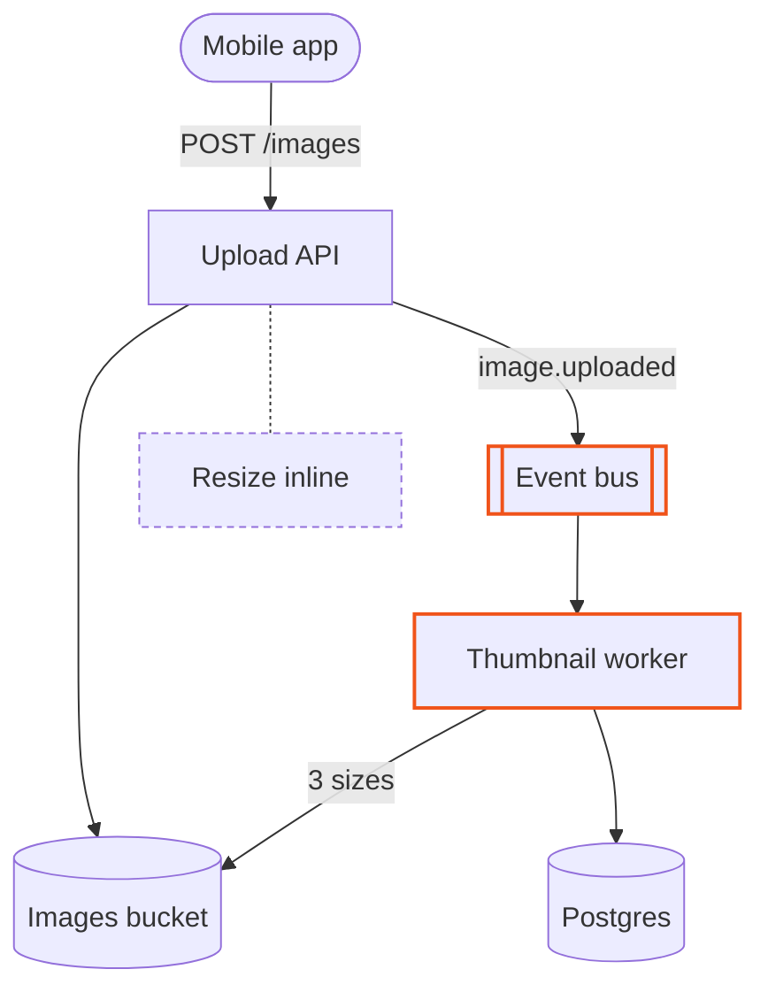
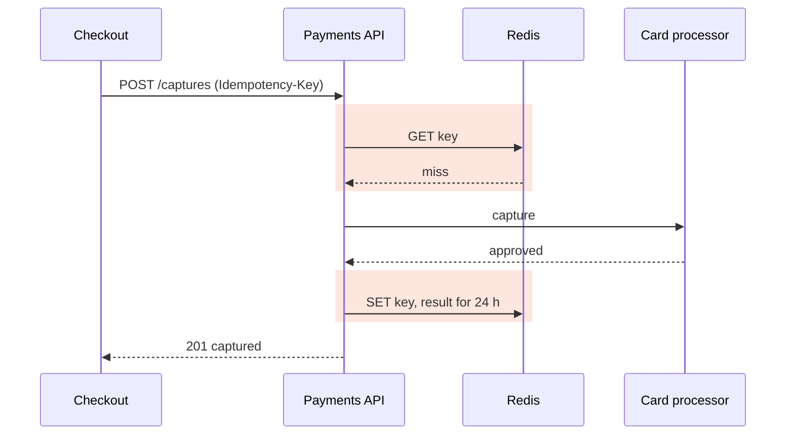
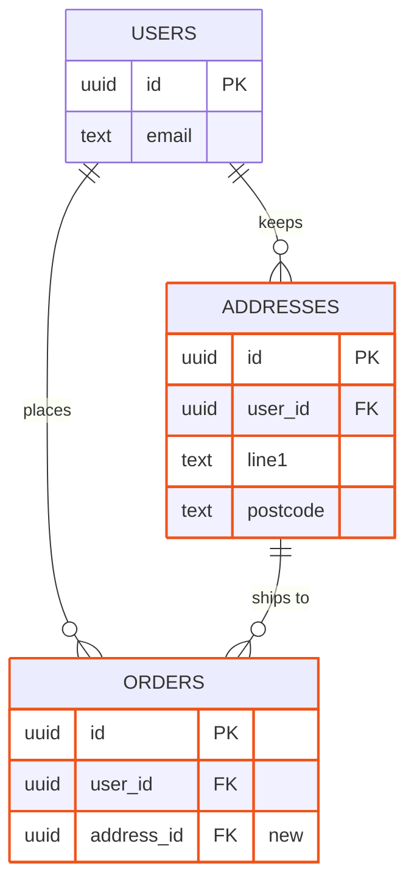
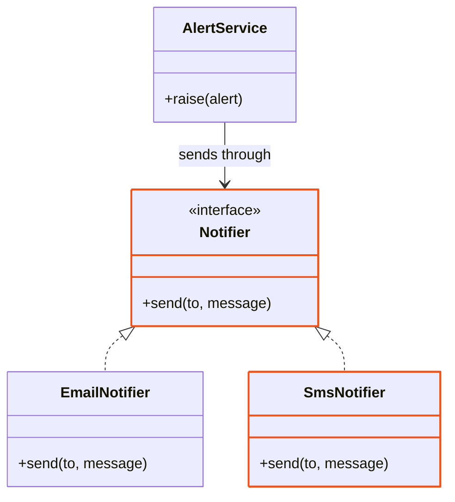
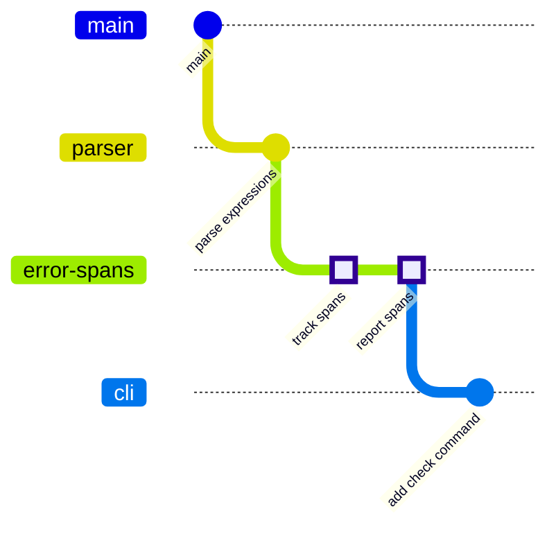

# Pull requests: a diagram of the change

Read this when a diagram goes into a pull request's description, or when a repository's instructions ask for one.
GitHub draws a ` ```mermaid ` block in a pull request with Mermaid.js 12.1.0 (read from its viewer in October 2026):
the same syntax Pele reads, so every rule of the skill holds, but GitHub's layout and its own light and dark theme.
None of this skill's look survives there, so the change is marked with two classes that read in both GitHub themes.
Every example below renders clean with `render.mjs --destination pr`, and its previews were looked at in both.

## When a pull request gets a diagram

Draw one when a reviewer would otherwise build the picture in their head from the diff:

- it changes who calls whom: a new service, queue, endpoint, or a new dependency between modules;
- it changes a message exchange: a new step in a protocol, a retry, a callback;
- it changes states, or the events that move between them;
- it changes the schema: a migration that adds, splits or links tables;
- it changes types or a public interface: a new abstraction and what implements it;
- it moves code across module or package boundaries;
- it touches branch history: a stacked pull request, a backport, a cherry-pick, a release branch;
- it changes numbers it measured: latency, size, cost, before and after.

Leave it out for a fix inside one function, a dependency bump, text, config or tests alone, and a refactor that adds
no new link. A diagram that restates the diff is noise: a diff sketch or a file tree does that job better.

## What it is drawn from

The facts are what the pull request work has already gathered: the commits, the diff against the base branch, the
files it adds, the routes, migrations, states or types they declare. When another skill wrote the description (Matt
Pocock's `pr`, for one), take the facts from what it read instead of reading again, and put the diagram in its
summary, where a diagram or a diff sketch goes. Every node comes from the diff or from the code it touches; a
neighbour the change does not touch stays only when the reader needs it to place the change.

## Which diagram

| The pull request… | Diagram | What marks the change |
| --- | --- | --- |
| changes who calls whom | flowchart | `:::changed` on what it adds or changes, `:::removed` on what it deletes |
| changes a message exchange | sequence | the new messages inside `rect rgba(240, 83, 26, 0.14)` … `end` |
| changes states | state | `class Name changed` |
| changes the schema | ER | `class TABLE changed` on the tables it adds or extends, `"new"` as a new column's comment |
| changes types or interfaces | class | `class Name:::changed` |
| touches branch history | git graph | `type: HIGHLIGHT` on the pull request's own commits; a cherry-pick marks itself |
| changes numbers it measured | XY chart | two bar series, `"before"` and `"after"` |

## Marking the change

Copy these two lines as they are; the script rejects any other class, and any fill or text colour, because a fill
reads in one GitHub theme only and an orange outline reads in both:

```text
classDef changed stroke:#f0531a,stroke-width:2px
classDef removed stroke-dasharray:4 3
```

- **One diagram, of the shape after the change**, with what the pull request adds or changes outlined in orange. A
  part it deletes stays in the picture, dashed and attached where it was by a dotted line, when the reader needs to
  see it go.
- **Outline what is new, and what changes its job.** A part whose only change is a new call to something new keeps no
  outline: the edge into the new part already says it. Outline everything the diff touches, and nothing stands out.
- **A second diagram of the shape before** only when the change replaces more than half of what was there: a
  rewrite, a flow replaced by another. Mark the parts that go `:::removed` in it.
- `:::key` and `:::ext` belong to this skill's theme, which GitHub does not carry: they draw nothing there.
- **Small:** the part the change touches and its neighbours, 15 nodes at most; the script counts. GitHub gives the
  description about 800 px, and Mermaid lays a graph out wider than Pele: a left-to-right chain of more than about
  five nodes goes `TD`.
- A one-line caption under the block says what changed, in the reader's words: "Uploads now resize in a worker, off
  the request path."

## Check it

```bash
node scripts/render.mjs change.mmd --destination pr
node scripts/render.mjs pr-body.md --destination pr
```

The first checks one diagram, the second every block of a description drafted in a file. The script lints the source
for GitHub, parses it with Pele, draws it with the same Mermaid.js GitHub uses (fetched once, about 5 MB, checked
against its hash) and writes a preview in GitHub's light and dark theme. Look at both: Mermaid's layout is not Pele's,
so only the preview shows a crossing or a label far from its edge. Without a browser it says what it skipped.

## Flowchart: who calls whom



- The deleted step hangs off the node that used to do it, by a dotted line (`-.-`), so the reader sees what moved.

## Sequence: a new exchange



- One `rect` around each run of new messages; the colour is the accent at 14 %, which reads on GitHub's white and on
  its dark page.

## State: new states

```mermaid
stateDiagram-v2
  accTitle: Deployment states after this pull request
  accDescr: A deployment goes from queued to rolling out to live; this change rolls it back on its own when the error rate passes 2 percent during the rollout.
  [*] --> Queued
  Queued --> RollingOut: approved
  RollingOut --> Live: all pods healthy
  RollingOut --> RollingBack: error rate over 2%
  RollingBack --> RolledBack: previous version healthy
  Live --> [*]
  RolledBack --> [*]
  class RollingBack,RolledBack changed
  classDef changed stroke:#f0531a,stroke-width:2px
```



## ER: a migration



- Mark the tables the migration adds and the ones that gain a column or a relation; a column it adds carries
  `"new"` as its comment. A table that only loses a column stays plain, and the caption names what was dropped.

## Class: a new interface



## Git graph: where the pull request sits



- `type: HIGHLIGHT` draws the pull request's commits as squares. A `cherry-pick` cannot take a type: it draws as a
  cherry, so in a backport the pull request's commit marks itself.
- Mermaid turns commit messages on their side in a left-to-right graph, and long ones run into the next branch's
  line: with messages longer than a few words, write `gitGraph TB:`.
- Use a git graph for a stack, a backport or a release branch, not for a branch that merges once into `main`: that is
  every pull request.

## XY chart: numbers before and after

```mermaid
xychart
  accTitle: Bundle size before and after code splitting
  accDescr: Gzipped JavaScript per entry point in kB; code splitting cuts app from 412 to 188, admin from 296 to 141 and login from 88 to 61.
  x-axis [app, admin, login]
  y-axis "gzipped (kB)" 0 --> 450
  bar "before" [412, 296, 88]
  bar "after" [188, 141, 61]
```



- Mermaid.js draws bar series on top of each other, not side by side: declare the series with the larger values first,
  or the smaller one disappears behind it. When "after" is larger, draw it as a `line`.
- No data labels: with two series, `showDataLabel` in Mermaid.js 12.1 prints the first series' values on the second
  one's bars. The numbers go in the caption or the description; the script rejects it.

## The repository rule

When the user says yes to diagrams in pull requests (see SKILL.md), add this section to the repository's agent
instructions, as it is:

```markdown
## Pull request diagrams

<!-- sumi-diagrams: pull request diagrams -->
When a pull request changes how components call each other, a message exchange, states, the database schema, types
or a public interface, module boundaries or branch history, put one Mermaid diagram of the change in its
description, drawn with the sumi-diagrams skill from what the pull request work already gathered. Leave it out for
fixes inside one function, dependency bumps, text, config or tests alone, and refactors that add no new link.
```

When the user says no, add this one line instead, so no agent asks again:

```markdown
<!-- sumi-diagrams: no pull request diagrams -->
```
