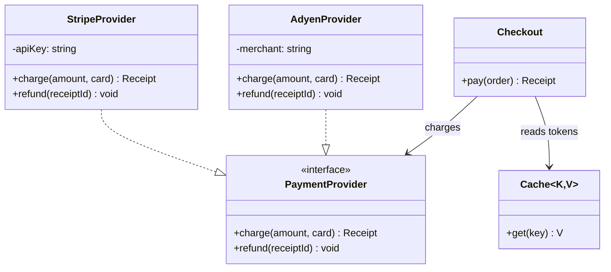
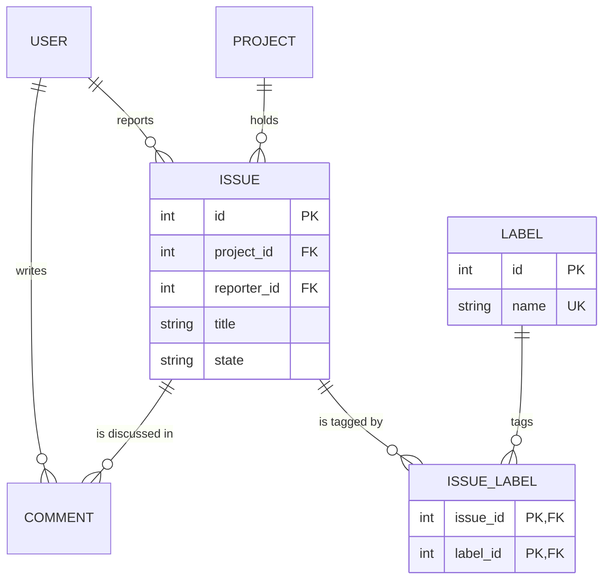
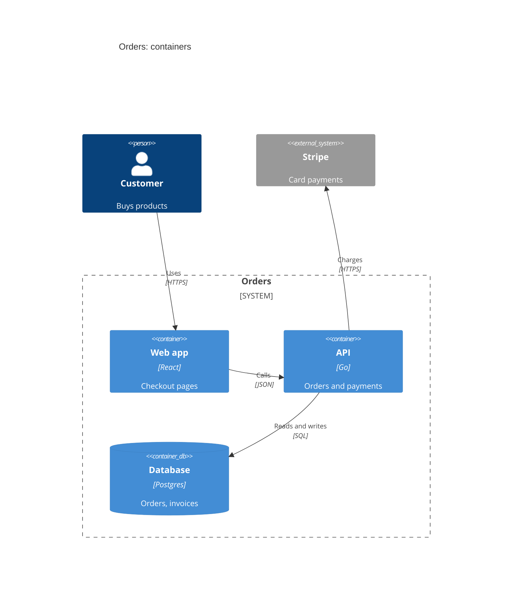
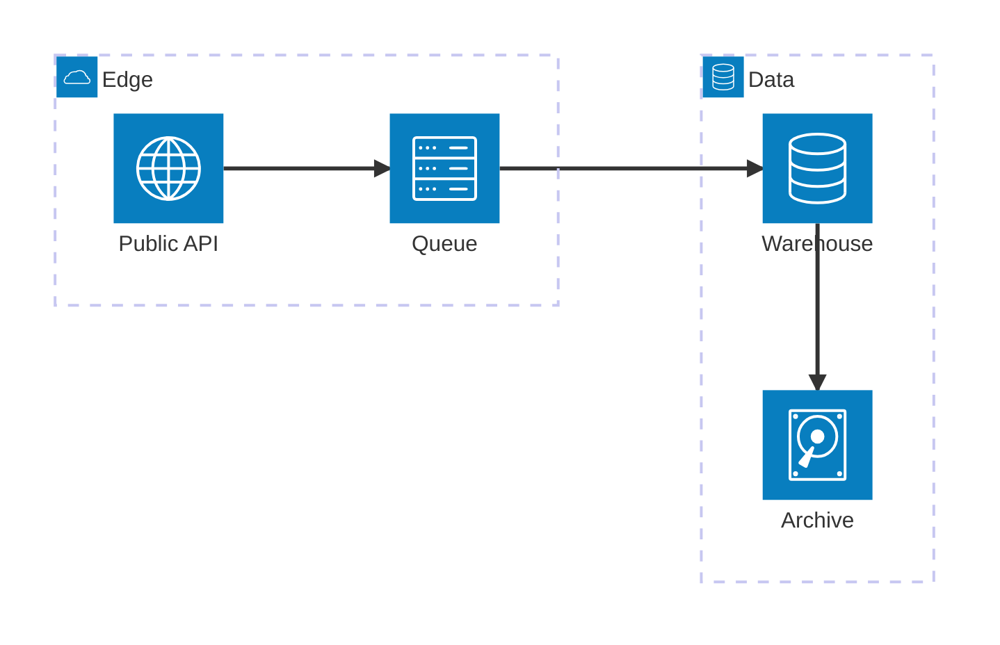
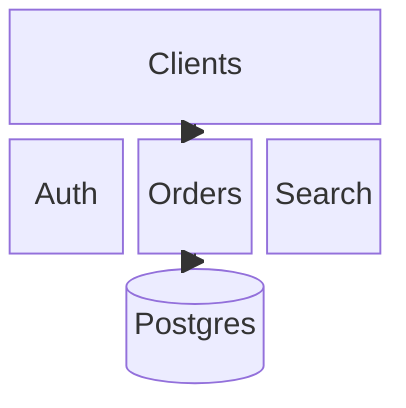
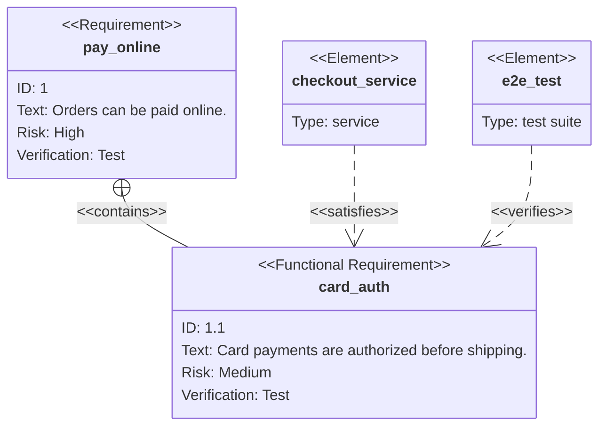
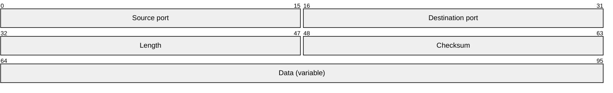

# Structure: class, ER, C4, architecture, block, requirement, packet

Read this when the question is "what holds what?", "what is it made of?" or "where does it run?". Every example below
renders clean with `scripts/render.mjs` on Pele 1.6.0.

## Class

Answers: which types exist, what they hold and do, and how they relate: an API surface, a plugin interface, a domain.

- Members: `+public`, `-private`, `#protected`, `~package`; a method has `()`, its return type follows it. Generics
  are `~T~`, never `<T>`. `<<interface>>`, `<<abstract>>`, `<<enumeration>>` go inside the braces.
- Relations: `<|--` inheritance, `..|>` realisation, `*--` composition, `o--` aggregation, `-->` association,
  `..>` dependency; `A "1" --> "*" B : label` adds cardinalities.
- `namespace Name { class A }` groups classes; `note for A "text"` adds a note.
- In a relation label a `<Word>` is dropped as an HTML tag (`reads Repo<Note>` shows "reads Repo"): write
  `reads Repo#lt;Note#gt;`. Members keep their angle brackets, but `~T~` is the generic form.
- Pele: many disconnected classes line up in one row and shrink: connect them, or split the picture.

## Entity relationship

Answers: which entities a database holds, their fields and keys, and how they relate.

- Cardinality ends: `||` exactly one, `|o` zero or one, `}|` one or more, `}o` zero or more; `--` identifying,
  `..` non-identifying. The relation label is a verb; quote it when it has spaces (`: "settled by"`).
- Attributes: `type name` then `PK`, `FK`, `UK` (comma separated) and an optional `"comment"`. Every attribute
  needs a type. One attribute per line.
- Show the fields the question needs (keys and the ones the reader asks about), not the whole table.

## C4

Answers: a software system at one zoom level: context (people and systems), containers, components, deployment.

- Headers: `C4Context`, `C4Container`, `C4Component`, `C4Dynamic`, `C4Deployment`. Elements: `Person`, `System`,
  `System_Ext`, `Container`, `ContainerDb`, `ContainerQueue`, `Component`, each `(id, "Name", "Tech", "Description")`;
  boundaries: `System_Boundary`, `Container_Boundary`, `Boundary`, `Deployment_Node`.
- `Rel(a, b, "Label", "Tech")`; `UpdateRelStyle(a, b, $offsetX="…", $offsetY="…")` moves a label by hand.
- C4 takes its visible title from `title`; Pele 1.6.0 ignores `accTitle` here, so give the title and `accDescr`,
  and the script uses the title as the SVG's accessible name.
- Layout: Pele places elements in source order, four to a row. `UpdateLayoutConfig($c4ShapeInRow="3",
  $c4BoundaryInRow="1")` changes the rows; declare people first, then the system, then the external systems, so
  the relations run one way.
- A relation label between two neighbours can touch the source's border (a known Pele 1.6.0 issue): keep the label
  and its technology short, or move the technology into the description.
- Pele 1.6.0 bug: in any other diagram, a label containing `C4Container`, `C4Component`, `C4Dynamic` or
  `C4Deployment` makes Pele read the whole text as C4. Reword the label.
- C4 is wide: past about eight elements, split by zoom level.

## Architecture

Answers: which services exist and how they connect, drawn as icons in groups.

- `service id(icon)[Label] in group`, `group id(icon)[Label]`, `junction id`. Pele has five built-in icons:
  `cloud`, `database`, `disk`, `internet`, `server`. Any other name draws an empty square: use these five.
- Every edge names its sides: `a:R --> L:b` (`L`, `R`, `T`, `B`); `-->` with heads, `--` without.
- `align row a b c` and `align column a d` pin services on a line.
- For a system with more than about ten parts, a flowchart with subgraphs reads better.

## Block

Answers: what sits where on a grid you arrange yourself: a memory layout, a board, a fixed topology.

- `columns N`, then blocks left to right; `id:2` spans two columns; `space` leaves a cell empty;
  `block:group:2 … end` nests a grid. Arrow blocks: `a<["Label"]>(right)`.
- Block cannot hold `accTitle`/`accDescr` statements: write them as `%%` comments, as above.
- You place everything yourself: reach for it only when the position means something.

## Requirement

Answers: which requirements exist, how they derive from each other, and what satisfies or verifies them.

- Outside `text`, a value with spaces must be quoted (`type: "test suite"`), and the bare word `test` is a
  keyword (a `verifymethod`), so `type: test` fails.
- Kinds: `requirement`, `functionalRequirement`, `interfaceRequirement`, `performanceRequirement`,
  `physicalRequirement`, `designConstraint`. Fields: `id`, `text`, `risk` (low, medium, high), `verifymethod`
  (analysis, inspection, test, demonstration).
- Relations: `contains`, `copies`, `derives`, `satisfies`, `verifies`, `refines`, `traces`.

## Packet

Answers: the fields of a header or a binary format, bit by bit.

- `start-end: "Field"` with bit numbers; a one-bit field is `106: "URG"`. Frontmatter
  `config: packet: bitsPerRow: 16` changes the row width.
