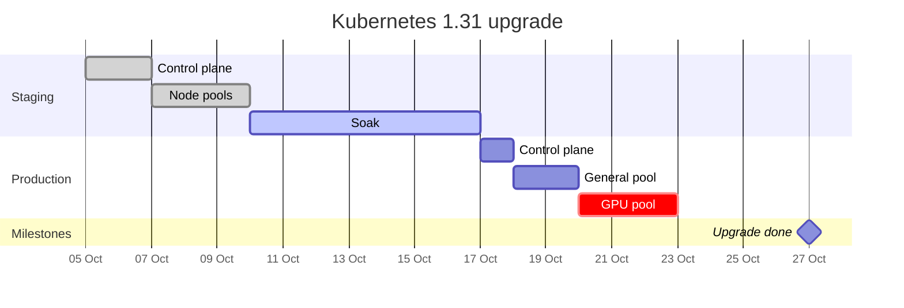
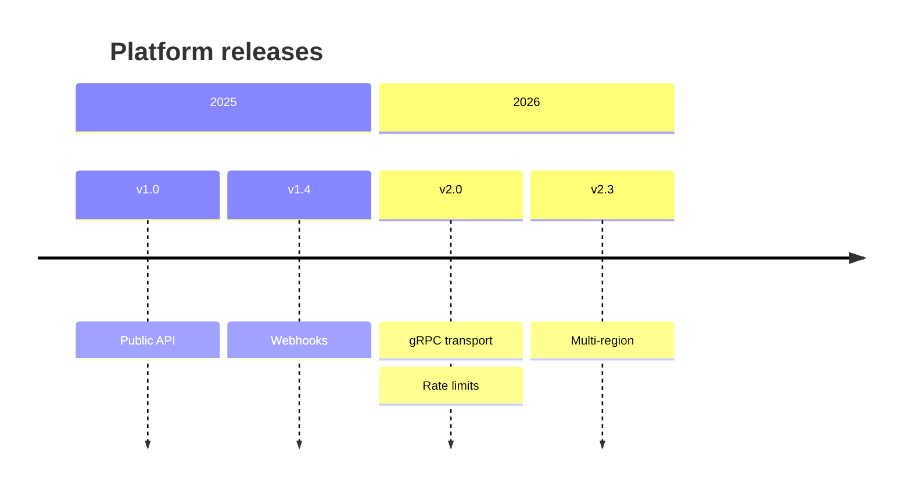
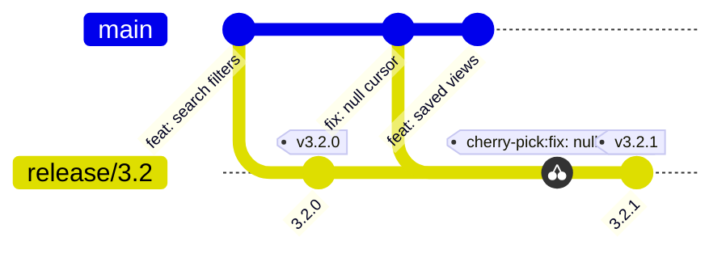
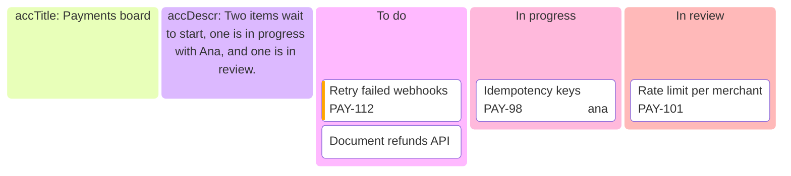

# Time: gantt, timeline, git graph, kanban

Read this when the question is "when?" or "where does each thing stand?". Every example below renders clean with
`scripts/render.mjs` on Pele 1.6.0.

## Gantt

Answers: when each task of a plan runs, how long, and what depends on what.

- `dateFormat` is how you write dates; `axisFormat` is how the axis prints them (`%b` month, `%d` day, `%Y` year).
  Every date must match `dateFormat`: a mismatch draws the task nowhere, without an error.
- A task is `Name :tags, id, start, length` where start is a date or `after id`, and length is `3d`, `2w` or an end
  date. Tags: `done`, `active`, `crit`, `milestone`. `excludes weekends` skips weekends.
- Bars are neutral in this theme; `crit` tasks and the today line take the accent. The render script's `--now`
  fixes "today" for a reproducible picture.

## Timeline

Answers: what happened when, in order: release history, an incident timeline, a roadmap of past milestones.

- `period : event : event`; a line starting with `:` adds an event to the period above. `section` groups periods.
- A period cannot hold a colon, quoted or not: an incident timeline writes `09#58;12 : Alerts fire`, which prints
  as 09:12. The script reports every time written with a colon.
- Between 640 px and its natural width a timeline does not adapt and scales down; past about eight periods, split.

## Git graph

Answers: how branches, merges and tags of a repository relate: a branching model, a release, a cherry-pick.

- `commit id: "…" tag: "…" type: HIGHLIGHT`, `branch name`, `checkout name`, `merge name`,
  `cherry-pick id: "…"`. Branches start from the branch checked out.
- Give every commit an `id`: unnamed commits get hashes like `0-9e3779b`, which read as noise.
- Each branch takes the next series colour, so keep to five or fewer.
- `branch hotfix order: 1` sets the lane order (lower is nearer `main`): put a branch next to the branches it merges
  into, so its curves do not cross every lane.

## Kanban

Answers: where each work item stands, by column.

- Columns at the first level, items indented under them; `@{ ticket: …, assigned: '…', priority: '…' }` adds
  metadata (`Very High`, `High`, `Low`, `Very Low`). Frontmatter `config: kanban: ticketBaseUrl: '…#TICKET#'` links
  tickets.
