<!--
  The showcase of toryo-loop, for the people deciding whether to use it. When the skill changes, update this file in
  place (AGENTS.md): keep its layout, its order and its voice, and change only what the change touched.

  Pictures: showcase/<name>.mmd is the source of showcase/<name>-light.svg and showcase/<name>-dark.svg, drawn with the
  sumi-diagrams skill in this repository. To render one again, from skills/toryo-loop/, run
      node ../sumi-diagrams/scripts/render.mjs showcase/<name>.mmd --destination readme --out showcase --now 2026-11-13
  When the skill changes a step, a mode or a file, correct the source first, then render it again.

  Keep each picture at or below its own width, so its text stays at the size the check measured: lifecycle 757 px,
  pipeline 800, modes 1121, setup 342, structure 562, out of GitHub's 880.
-->

<h1 align="center">🪚 Toryo loop · 棟梁</h1>

<p align="center">
  <b>Your coding agent as the master of a crew: it briefs, inspects and lands; the crew builds.</b><br>
  A queue of GitHub issues, executors in worktrees, a reviewer on another model, and a land that checks it landed.
</p>

<p align="center">
  <a href="#install">Install</a> &nbsp;·&nbsp;
  <a href="#the-life-of-a-ticket">The loop</a> &nbsp;·&nbsp;
  <a href="#proof-not-opinion">The review</a> &nbsp;·&nbsp;
  <a href="#set-up-once">The setup</a> &nbsp;·&nbsp;
  <a href="SKILL.md">SKILL.md</a> &nbsp;·&nbsp;
  <a href="CHANGELOG.md">Changelog</a>
</p>

<br>

<p align="center">
  <picture>
    <source media="(prefers-color-scheme: dark)" srcset="showcase/lifecycle-dark.svg">
    
  </picture>
</p>

<p align="center"><sub>The life of a ticket: three tracks in, one proof rule, one land check out.</sub></p>

<br>

## The master carpenter

A toryo (棟梁) plans the house, hands each part to a crew and inspects it before it goes up. The toryo does not
saw the beams. With this skill your coding agent's session is the **master**: it takes the next ticket from a queue in a
GitHub issue, writes a brief, and hands it to an **executor** subagent that builds it in its own worktree, tests first,
and stops when its draft pull request is open. A **reviewer** subagent, in a fresh context and on a different model,
reviews the pull request while CI runs. The master sends proved bugs back for one fix round, lands the pull request,
checks that it really merged, cleans up, and updates the issues. Then it takes the next ticket.

It covers what a single-session plan runner does not: the queue, the pull requests, the landing and the trackers.

## The life of a ticket

Before a ticket starts, the master gives it a track:

| Track | When | What it gets |
| --- | --- | --- |
| **A** full | it touches a core path, changes what a number means, has an open design choice, or is large | a plan, a plan review, the build, a high review, one fix round, a low re-check |
| **B** light | a clear fix of about 100 lines or less | the build and one high review |
| **C** mechanical | docs, config, a rename | a cheaper executor and one low review |

The trials behind the loop showed that a plan pays on large or meaningful changes and not on small ones, and that
executors at medium effort cost about 40 % less with the same number of fix rounds. Those are the defaults.

## Two tickets in flight, never three

<p align="center">
  <picture>
    <source media="(prefers-color-scheme: dark)" srcset="showcase/pipeline-dark.svg">
    
  </picture>
</p>

While ticket N is in review, ticket N+1 builds on files disjoint from N's. A third waits, however idle the master
is. Every pull request is based on the default branch, never stacked.

## Three modes

<p align="center">
  <picture>
    <source media="(prefers-color-scheme: dark)" srcset="showcase/modes-dark.svg">
    
  </picture>
</p>

You say how far it goes: **autonomous** works through the queue, **finish and stop** lands what is in flight and
starts nothing new, **one ticket** does one and reports. Every mode stops on a check nobody can explain. Between
tickets it sends no status chatter; the stop report is a table of what landed and one question: resume, or stay
stopped?

## Proof, not opinion

- A finding is a bug only with a proof: a test that fails, a red check, or an input and its wrong output. Everything
  else is a nit, and nits go to one rolling issue instead of opening another round.
- One fix round, then a low re-check of the interdiff by the same reviewer.
- The reviewer runs on another model than the executor. When none of the listed models is available, the review still
  runs, on the executor's model in a fresh context, and the pull request says so.
- A design question inside a fix round is the master's: it takes the simplest safe option, writes it on the issue, and
  sends any "for now X, later Y" to a deferred issue with its trigger. Questions that change what the work means wait
  in a decision issue until you ask for them, one at a time, with a recommendation.

## A land that checks it landed

A merge command that prints success while the pull request stays open has landed nothing. The master chains the check
to the land, and the clean-up to the check:

```bash
gh pr merge 87 --merge --match-head-commit 3f2a9c1 &&
  test "$(gh pr view 87 --json state -q .state)" = MERGED &&
  echo "87 merged"
```

Only then does it delete the branch, the worktree and the fetched ref, and only a branch whose patches are all in
the default branch.

## Set up once

<p align="center">
  <picture>
    <source media="(prefers-color-scheme: dark)" srcset="showcase/setup-dark.svg">
    
  </picture>
</p>

<p align="center"><sub>The first run in a repository: no ticket starts until the setup has landed.</sub></p>

The method is the same everywhere; your repository's values are not. The first run reads what the repository already
says, asks the rest once (the queue issue, the check commands, the land command, the models, the core paths) and writes
them to `docs/agents/toryo-loop.md`. It writes the executor, executor-light and reviewer agent files for Claude Code,
and offers a small guard hook that refuses a commit on the default branch and a worktree past the cap. Every brief the
master writes starts from a template in `assets/`; [samples/](samples/) has each one filled for a made-up repository.

Claude Code is the reference harness. On an agent without subagents, each role runs as a new session with its brief.

<p align="center">
  <picture>
    <source media="(prefers-color-scheme: dark)" srcset="showcase/structure-dark.svg">
    
  </picture>
</p>

<p align="center"><sub>What the skill ships: the loop in SKILL.md, the details behind pointers, the templates the
first run copies.</sub></p>

## Tested before it shipped

Nine decisions the loop gets wrong without help, each a scenario on a made-up repository with assertions, answered by
a fresh agent without the skill and then with it:

| Scenario | Without | With |
| --- | --- | --- |
| Pick the next ticket whose files are disjoint | 5/6 | 6/6 |
| Classify five tickets into tracks | 4/5 | 5/5 |
| Sort a review into bugs and nits | 3/7 | 7/7 |
| A land that printed success but did not merge | 4/5 | 5/5 |
| "Finish what's in flight and stop" | 4/5 | 5/5 |
| A design question in a fix round | 4/4 | 4/4 |
| The reviewer's model is refused | 1/4 | 4/4 |
| A third ticket is free | 0/3 | 3/3 |
| The first run in a repository | 1/5 | 5/5 |

The cases are in [evals/evals.json](evals/evals.json).

## Install

Any agent ([Claude Code, Codex, Cursor, Gemini CLI, Copilot and more](https://github.com/vercel-labs/skills)), with
Node.js:

```bash
npx skills add exdsgift/shuji-skills --skill toryo-loop
```

Claude Code, as the `shuji` plugin, which brings every shuji skill and runs this one as `/shuji:toryo-loop`:

```bash
claude plugin install shuji --marketplace exdsgift/shuji-skills
```

Then ask in plain words:

> Work through the queue with agents.<br>
> Do one ticket end to end and report back.<br>
> Finish what's in flight and stop.<br>
> Set up executor and reviewer agents for this repository.

The loop needs `gh`, signed in with access to the repository's issues and pull requests, and `git` worktrees. The
guard hook needs `python3` or `jq`.

When the skill itself fails, not your request or your machine, the agent offers to report it here as an issue. It
shows you the draft, which leaves out your code and your words, and posts it only after you say yes.

<br>

<p align="center"><sub>The skill is under the <a href="LICENSE">MIT license</a>; the setup file, briefs and agent files
it writes into your repository are yours to use without its notice.</sub></p>
